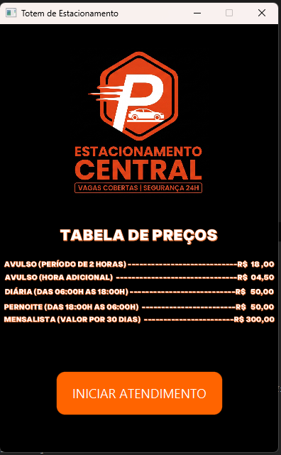

# Sistema de Pagamento de Estacionamento — Arquitetura Monolítica

Projeto da disciplina de **Engenharia de Software III**: totem de autoatendimento de um estacionamento,
desenvolvido em Java como um **monólito em camadas** (interface, regras de negócio e persistência
em um único processo), aplicando os padrões GoF **Facade**, **State** e **Strategy**.

**Equipe:** Augusto Barbosa, Jéssica Soares, Keteli Lino e Nicolas Borges

📄 Documentação completa (requisitos, regras de negócio, arquitetura, diagramas e plano de testes):
[`docs/Documentacao_Monolitico_Estacionamento.md`](docs/Documentacao_Monolitico_Estacionamento.md)

---

## Funcionalidades

| Caso de uso | Ator | O que faz |
|---|---|---|
| UC-01 Registrar Entrada | Motorista | Informa a placa e o tipo de uso e recebe o ticket com o horário de entrada |
| UC-02 Realizar Pagamento | Motorista | Consulta o ticket, vê o tempo e o valor e paga **em dinheiro**, com troco |
| UC-03 Emitir Nota Fiscal | Sistema | Emite a nota fiscal (CPF opcional, impresso mascarado) e o comprovante |
| UC-04 Liberar Saída | Sistema | Libera a cancela somente para ticket pago dentro da tolerância de 15 min |
| UC-05 Registrar Entrada Manualmente | Operador de Caixa | Gera o ticket quando ele não foi emitido (horário do relógio do sistema) |
| UC-06 Liberar Saída Manualmente | Operador de Caixa | Ajusta o horário de saída; o motorista paga em seguida no totem |
| UC-07 Alterar Tarifa | Operador de Caixa | Troca o tipo de tarifa de um ticket não pago, sem alterar a entrada |

O Operador de Caixa usa o **mesmo totem**, desbloqueado por um código de autorização. O totem volta a
ficar bloqueado após cada ação, e toda ação é registrada em log (operador, ticket, ação e data/hora).

## Tela inicial do totem

<p align="center">
  
</p>

## Tabela de preços

| Tarifa | Valor |
|---|---|
| Avulso | R$ 18,00 até 2 h; depois R$ 4,50/h cobrados em frações de 15 min (R$ 1,125 por fração) |
| Diária (06h–18h) | R$ 50,00 por até 12 h; o que passar é cobrado a R$ 4,50/h em frações de 15 min |
| Pernoite (18h–06h) | R$ 50,00 por até 12 h; o que passar é cobrado a R$ 4,50/h em frações de 15 min |
| Mensalista | R$ 300,00 uma vez por mês (cobrado na primeira saída do mês) |
| Convênio | 10% de desconto sobre a tarifa avulsa |
| Carência | Permanência de até 15 min não é cobrada (avulso e convênio) |

## Padrões de projeto (GoF)

| Padrão | Onde | Para quê |
|---|---|---|
| **Facade** | `EstacionamentoFacade` | Ponto único de entrada do totem: coordena ticket, tarifa, cobrança, nota fiscal, banco, cancela e vagas |
| **State** | `Ticket` + `TicketState` (Em Aberto, Aguardando Pagamento, Pago, Expirado, Finalizado) | Garante as transições do ticket e impede abrir a cancela sem pagamento |
| **Strategy** | `TarifaStrategy` + uma classe por tarifa | Cada regra de preço isolada; nova tarifa = nova classe, sem mexer no caixa |

## Tecnologias

- Java 21 (compatível com JDK 25) e JavaFX 21 (telas FXML)
- Maven
- Banco H2 embutido, acessado via JDBC
- JUnit 5, Mockito e JaCoCo

## Como executar

**NetBeans:** *File → Open Project*, escolher a pasta do repositório e clicar em **Run**.

**Linha de comando** (na raiz do repositório):

```
mvn javafx:run
```

O banco de dados é criado automaticamente na pasta `dados/` na primeira execução.

**Código de autorização do Operador de Caixa (demonstração):** `1234`
(gravado no banco apenas como hash SHA-256).

## Testes

```
mvn test
```

- **85 testes** em 5 classes: `TarifaAvulsaStrategyTest`, `TicketStateTest`, `EstacionamentoFacadeTest`,
  `NFTest` e `VeiculoDaoTest` — todos aprovados.
- Cobertura (JaCoCo): **88% das linhas** nas classes de domínio. Relatório gerado em
  `target/site/jacoco/index.html`.

## Estrutura do repositório

```
pom.xml
src/main/java/estacionamento
  App.java              ponto de entrada (main)
  ui/                   Totem (JavaFX) e controllers das telas
  facade/               EstacionamentoFacade e exceções
  domain/               Ticket, Pagamento, Comprovante, NF, Operador, TipoMotorista, AcaoLog
  domain/estado/        estados do ticket (padrão State)
  domain/tarifa/        tarifas (padrão Strategy)
  service/              Cobranca, Cancela, ControleVagas
  dao/                  VeiculoDao (JDBC)
src/main/resources      telas .fxml e imagens do totem
src/test/java           testes JUnit / Mockito
docs/                   documentação e diagramas UML (.drawio e .jpg)
```

## Diagramas

| Diagrama | Arquivo |
|---|---|
| Casos de uso | [docs/imagens/CASODEUSOMONO.jpg](docs/imagens/CASODEUSOMONO.jpg) |
| Arquitetura | [docs/imagens/DiagramaDeArquiteturaMono.jpg](docs/imagens/DiagramaDeArquiteturaMono.jpg) |
| Classes (original) | [docs/imagens/Diagrama_Classes_Ticket.jpg](docs/imagens/Diagrama_Classes_Ticket.jpg) |
| Classes com padrões GoF | [docs/imagens/DiagramaClassesGoFMono.jpg](docs/imagens/DiagramaClassesGoFMono.jpg) |
| Sequência | [docs/imagens/DiagramaSequenciaMono.jpg](docs/imagens/DiagramaSequenciaMono.jpg) |
| Modelo de dados | [docs/imagens/DiagramaModeloDadosMono.jpg](docs/imagens/DiagramaModeloDadosMono.jpg) |
| Padrão Strategy | [docs/imagens/Diagrama_GoF_Strategy.jpg](docs/imagens/Diagrama_GoF_Strategy.jpg) |
| Padrão State (classes / estados) | [docs/imagens/Diagrama_GoF_State_Classes.jpg](docs/imagens/Diagrama_GoF_State_Classes.jpg) · [docs/imagens/Diagrama_GoF_State_Estados.jpg](docs/imagens/Diagrama_GoF_State_Estados.jpg) |
| Padrão Facade | [docs/imagens/Diagrama_GoF_Facade.jpg](docs/imagens/Diagrama_GoF_Facade.jpg) |

Os arquivos `.drawio` com o mesmo nome podem ser abertos e editados no [draw.io](https://www.drawio.com/).
