# Documentação do Software — Sistema de Pagamento de Estacionamento (Arquitetura Monolítica)

| Campo | Valor |
|---|---|
| **Versão do documento** | 1.2 |
| **Data** | 20/11/2026 |
| **Autor(es)** | Augusto, Jéssica, Keteli, Nicolas |
| **Status** | Em revisão |
| **Aprovado por** | [preencher] |

## Histórico de Revisões

| Versão | Data | Autor | Descrição da alteração |
|---|---|---|---|
| 1.0 | 15/11/2026 | Jéssica da Silva Soares | Criação do documento seguindo os padrões e conceitos da disciplina de engenharia de software III |
| 1.1 | 17/11/2026 | Jéssica da Silva Soares | Ajustes dos Diagramas de arquitetura de software, banco de dados e diagramas ajustados para o padrão GoF. Inclusão do ator Operador de Caixa e dos casos de uso UC-05 (Registrar Entrada Manualmente) e UC-06 (Liberar Saída Manualmente); novo RF-09 e RN-12; novos casos de teste CT-15 a CT-17. Operador de Caixa passa a atuar só no totem, desbloqueado por código de autorização, para ajustar horários; o pagamento é sempre do motorista (novo RF-10, CT-19; CT-18 passa a ser no totem) |
| 1.2 | 20/11/2026 | Jéssica da Silva Soares | Código implementado e testado. Pagamento somente em dinheiro (sem APIs de cartão/PIX; novo RN-14). Tarifa diária de R$ 50,00 (06h–18h; novo RN-13). Mensalista paga R$ 300,00 uma vez por mês (RN-03). O Operador de Caixa não altera o horário de entrada: registra a entrada com o relógio do sistema (RF-09) e pode alterar o tipo de tarifa (novo UC-07 / RF-11). Novas tabelas Operador e Log_Operacao; Pagamento passa a referenciar o Ticket. Novos casos de teste CT-20 a CT-23; diagramas de casos de uso, classes, Strategy, sequência e dados atualizados |

---

## Sumário

1. [Visão Geral](#1-visão-geral)
2. [Escopo do Projeto](#2-escopo-do-projeto)
3. [Requisitos Funcionais](#3-requisitos-funcionais)
4. [Requisitos Não Funcionais](#4-requisitos-não-funcionais)
5. [Regras de Negócio](#5-regras-de-negócio)
6. [Projeto e Arquitetura do Software](#6-projeto-e-arquitetura-do-software)
7. [Plano e Casos de Teste](#7-plano-e-casos-de-teste)
8. [Matriz de Rastreabilidade](#8-matriz-de-rastreabilidade-requisitos-x-testes-x-código-fonte)
9. [Glossário](#9-glossário)
10. [Anexos e Referências](#10-anexos-e-referências)

---

## 1. Visão Geral

### 1.1 Propósito do documento
Este documento descreve os requisitos, as regras de negócio, a arquitetura, os padrões de projeto e o plano de testes do **Sistema de Pagamento de Estacionamento**.

- **Diagrama de casos de uso** — "Sistema de Pagamento de Estacionamento";
- **Diagrama de classes** — `Diagrama_Classes_Ticket.drawio` (`Ticket`, `Tarifa`, `Pagamento`, `Comprovante`, `NF`) e `DiagramaClassesGoFMono.drawio` (completo, com os padrões GoF);
- **Diagrama de sequência** — registro do veículo, cálculo do valor e pagamento (`Motorista`, `Totem`, `Veiculo`, `VeiculoDao`, `Cobrança`, `NotaFiscal`).

Destina-se à equipe de desenvolvimento, à equipe de QA, ao professor/avaliador e aos demais stakeholders.

### 1.2 Descrição resumida do sistema
O sistema controla a permanência de veículos em um estacionamento. Na entrada, o motorista informa os dados do veículo no **totem** e recebe um **ticket** com o horário de entrada. Na saída, o motorista solicita o pagamento: o sistema consulta o ticket, **calcula o valor conforme a tarifa** (avulso, diária, pernoite ou mensalista), recebe o pagamento em dinheiro (com troco), emite **comprovante e nota fiscal** e **libera a saída**. Toda a lógica roda em **um único processo (monólito)**: interface do totem, regras de negócio, cálculo de tarifa, pagamento e persistência.

### 1.3 Stakeholders

| Nome / Papel | Responsabilidade | Contato |
|---|---|---|
| Product Owner | Definir a tabela de preços e as regras de cobrança | [preencher] |
| Arquiteto de Software | Definir as camadas do monólito e os padrões GoF | [preencher] |
| Time de Desenvolvimento | Implementar totem, cálculo de tarifas, pagamento e emissão de documentos | [preencher] |
| Time de QA | Elaborar e executar testes JUnit e casos de teste CT-XX | [preencher] |
|  Patrocinador | Administração do estacionamento / shopping | [preencher] |
| Usuário final | Motorista (uso avulso, pernoite ou mensalista) | — |
| Operador de Caixa | Desbloquear o totem com código de autorização para registrar entradas sem ticket, ajustar o horário de saída e alterar a tarifa em casos de exceção (não altera o horário de entrada) | — |

---

## 2. Escopo do Projeto

### 2.1 Objetivos do projeto
- Automatizar a entrada, a cobrança e a saída de veículos sem necessidade de operador.
- Calcular corretamente o valor devido conforme o tempo de permanência e o tipo de uso.
- Emitir comprovante de pagamento e nota fiscal de forma automática.
- Impedir a saída de veículos sem pagamento válido.

### 2.2 Dentro do escopo (In Scope)
- Registro de entrada do veículo com horário (ticket).
- Cálculo do valor por tarifa: avulso (2 primeiras horas + adicional por hora/fração), diária (06h–18h) e pernoite (18h–06h), cada uma cobrindo 12 h com excedente em frações de 15 min, e mensalista (uma vez por mês).
- Registro de pagamento em dinheiro (valor devido, valor recebido e troco).
- Emissão de comprovante e de nota fiscal (com CPF, quando informado).
- Liberação da saída após pagamento.
- Ações do Operador de Caixa no próprio totem, desbloqueado por código de autorização, em casos de exceção: registrar a entrada quando o ticket não foi emitido (com o horário do sistema), ajustar o horário de saída (`registrarSaidaManualmente`) e alterar o tipo de tarifa. O operador **não altera o horário de entrada**, e o pagamento continua sendo feito pelo motorista no totem.

### 2.3 Fora do escopo (Out of Scope)
- Pagamento por cartão, PIX ou qualquer API externa: o totem aceita **somente dinheiro**.
- Reconhecimento automático de placas (OCR/câmeras).
- Reserva de vagas e aplicativo móvel.
- Emissão de NF-e junto à SEFAZ (nota fiscal simulada/impressa).

### 2.4 Premissas
- O horário de entrada é registrado automaticamente pelo relógio do sistema.
- O valor de R$ 18,00 (avulso) cobre as **2 primeiras horas** (inferido de `valorHoraApos2h`).
- A fração de 15 minutos após 2 h vale ¼ do valor/hora (R$ 4,50 ÷ 4 = R$ 1,125) — o diagrama declara `valorFracao15min` sem valor.
- Existe um único totem/caixa por instância do sistema.
- O sistema não usa APIs externas; toda a cobrança é feita em dinheiro no próprio totem.

### 2.5 Restrições
- Linguagem Java (tipos `LocalDateTime` e `main(String[])` presentes no diagrama de classes).
- Arquitetura monolítica (um único executável e processo).
- Uso de pelo menos um padrão GoF (adotados: Strategy, State e Facade).
- Testes unitários com JUnit em, no mínimo, 3 classes.
- Prazo do semestre letivo.

### 2.6 Riscos identificados

| ID | Risco | Probabilidade | Impacto | Mitigação |
|---|---|---|---|---|
| R-01 | Cálculo incorreto da tarifa em valores limite (exatamente 2 h, frações de 15 min) | Média | Alto | Strategy isolada por tarifa + testes parametrizados de borda |
| R-02 | Cancela liberada sem pagamento ou após o prazo de saída | Baixa | Alto | Padrão State no ticket (só `Pago` dentro do prazo libera) |
| R-03 | Regras de preço mudarem com frequência (feriados, convênios) | Alta | Médio | Novas tarifas como novas Strategies, sem alterar o caixa |
| R-04 | Falha no pagamento após emissão do ticket de saída | Baixa | Médio | Facade só libera saída após `confirmaPagamento()` |
| R-05 | Vazamento de CPF e placa (dados pessoais) | Baixa | Alto | Controles da LGPD (seção 4.3) |

### 2.7 Entregáveis
- Código-fonte do monólito (Java).
- Diagramas UML (casos de uso, classes e sequência).
- Testes unitários JUnit e relatório de execução.
- Este documento de software.

---

## 3. Requisitos Funcionais

> Requisitos funcionais descrevem **o que** o sistema deve fazer.

### Convenção de ID
`RF-XX` (Requisito Funcional número XX)

### 3.1 Lista de Requisitos Funcionais

| ID | Descrição | Prioridade | Origem / Solicitante | Status |
|---|---|---|---|---|
| RF-01 | O sistema deve registrar a entrada do veículo, gerando um ticket com o horário de entrada. | Alta | UC "Registrar Entrada"; seq. passos 1–5; `Ticket()` | Implementado |
| RF-02 | O sistema deve consultar o ticket e calcular o valor devido conforme o tempo de permanência e a tarifa aplicável. | Alta | Seq. passos 6–12; `Tarifa.calcularAvulso(ticket)` | Implementado |
| RF-03 | O sistema deve permitir que o Motorista realize o pagamento no totem, somente em dinheiro, com cálculo de troco (sem APIs de cartão/PIX). | Alta | UC "Realizar Pagamento"; seq. passos 13–16; classe `Pagamento` | Implementado |
| RF-04 | O sistema deve emitir nota fiscal ao concluir o pagamento, incluindo o CPF quando informado. | Alta | UC "Emitir Nota Fiscal" (`<<include>>`); classe `NF`; seq. `<<create>>` NotaFiscal e passo 20 | Implementado |
| RF-05 | O sistema deve emitir comprovante de pagamento. | Média | Classe `Comprovante.imprimir()` | Implementado |
| RF-06 | O sistema deve liberar a saída do veículo após o pagamento confirmado, atualizando o ticket. | Alta | UC "Liberar Saída" (`<<include>>`); seq. passos 17–19 | Implementado |
| RF-07 | O sistema deve permitir que o Operador de Caixa, com o totem desbloqueado por código de autorização, ajuste o horário de saída de um ticket; o pagamento é finalizado pelo Motorista no totem. | Média | UC-06 "Liberar Saída Manualmente" (`<<extend>>` UC-04); seq. passos 36–45; `Ticket.registrarSaidaManualmente(saida)` | Implementado |
| RF-08 | O sistema deve suportar os tipos de cobrança avulso, diária, pernoite e mensalista (além de convênio e isenção por carência). | Alta | Atributos `avulso`, `pernoite`, `mensalista` de `Tarifa`; `TarifaDiariaStrategy` | Implementado |
| RF-09 | O sistema deve permitir que o Operador de Caixa, com o totem desbloqueado por código de autorização, registre a entrada de um veículo cujo ticket não foi emitido, gerando o ticket com o horário do relógio do sistema (o operador não altera o horário de entrada). | Média | UC-05 "Registrar Entrada Manualmente" (`<<extend>>` UC-01); seq. passos 29–35 | Implementado |
| RF-10 | O sistema deve desbloquear o modo de ajuste do totem somente após o Operador de Caixa informar um código de autorização válido, e bloqueá-lo novamente ao fim do ajuste. | Alta | UC-05, UC-06 e UC-07; seq. passos 21–28, 44 e 54 | Implementado |
| RF-11 | O sistema deve permitir que o Operador de Caixa, com o totem desbloqueado, altere o tipo de tarifa de um ticket ainda não pago, mantendo o horário de entrada; o valor é recalculado com a nova tarifa. | Média | UC-07 "Alterar Tarifa"; seq. passos 46–55; `Ticket.alterarTipo(tipo)` | Implementado |

### 3.2 Detalhamento dos Requisitos

#### RF-01 — Registrar entrada
- **Descrição:** O motorista informa os dados do veículo no totem; o sistema cria o ticket com `horarioEntrada` e o persiste.
- **Ator(es):** Motorista
- **Pré-condições:** Totem disponível; há vaga no estacionamento.
- **Fluxo principal:**
  1. Motorista informa os dados do veículo (`informadadosVeiculo`).
  2. Totem envia `registraVeiculo(dados)`.
  3. O sistema registra o veículo/ticket no `VeiculoDao` (`registraVeiculo()`).
  4. `VeiculoDao` confirma o registro (`confirmaRegistro()`).
  5. Totem recebe os dados do ticket (`retornaDados()`) e o entrega ao motorista.
- **Fluxos alternativos / exceções:**
  - Dados do veículo inválidos/incompletos → totem solicita novamente.
  - Veículo já com ticket em aberto → sistema recusa novo ticket.
- **Pós-condições:** Ticket no estado **Em Aberto** com `horarioEntrada` preenchido.
- **Critérios de aceite:**
  - [ ] Ticket criado com horário de entrada igual ao horário do sistema.
  - [ ] Ticket persistido e recuperável pela consulta.
- **Requisitos relacionados:** RN-10, RNF-L03

#### RF-02 — Calcular valor devido
- **Descrição:** Ao solicitar o pagamento, o sistema consulta o ticket, define o horário de saída e calcula o valor com a estratégia de tarifa adequada.
- **Ator(es):** Sistema
- **Pré-condições:** Ticket existente no estado Em Aberto.
- **Fluxo principal:**
  1. Motorista solicita pagamento (`solicitaPagamento`).
  2. Totem pede os dados do ticket (`dadosTicket()`).
  3. Sistema consulta o ticket no `VeiculoDao` (`consultaTicket()` / `retornaConsulta()`).
  4. Sistema calcula o valor (`calculaValor()`).
  5. Totem recebe o preço e as informações de pagamento (`retornaPreco()`, `infoPagamento()`).
- **Fluxos alternativos / exceções:**
  - Permanência dentro da carência → valor R$ 0,00 (RN-07).
  - Ticket inexistente → mensagem de erro.
- **Pós-condições:** Ticket no estado **Aguardando Pagamento** com valor calculado.
- **Critérios de aceite:**
  - [ ] Até 2 h → R$ 18,00.
  - [ ] 2 h 30 min → R$ 18,00 + 2 frações = R$ 20,25.
  - [ ] Pernoite e diária até 12 h → R$ 50,00; 16 h → R$ 50,00 + 16 frações = R$ 68,00.
  - [ ] Mensalista → R$ 300,00 na primeira saída do mês; R$ 0,00 nas demais saídas do mesmo mês.
- **Requisitos relacionados:** RN-01 a RN-07, RF-08

#### RF-03 — Realizar pagamento
- **Descrição:** O motorista paga no totem o valor calculado, inserindo as notas de dinheiro (única forma aceita; o sistema não usa APIs de cartão/PIX). Isso vale também depois que o Operador de Caixa ajusta um horário (RF-07): o operador nunca recebe o pagamento.
- **Ator(es):** Motorista
- **Pré-condições:** Ticket Aguardando Pagamento com valor calculado.
- **Fluxo principal:**
  1. Motorista insere as notas no totem (`insereDinheiro(notas)`).
  2. Totem envia os dados com o valor recebido (`dadosPagamento(valorRecebido)`).
  3. Sistema cria `Pagamento(valorPgto, "DINHEIRO", valorRecebido)` e o processa na `Cobrança` (`processaPagamento()`), que só aprova se o valor recebido cobrir o valor devido.
  4. `Cobrança` confirma (`confirmaPagamento()`).
  5. Sistema cria a nota fiscal (RF-04), registra o pagamento (RF-06) e libera a saída.
- **Fluxos alternativos / exceções:**
  - Valor inserido insuficiente → ticket permanece Aguardando Pagamento; mensagem informando quanto falta.
  - Valor inserido maior que o devido → o totem calcula e entrega o troco.
  - Valor devido igual a zero (carência ou mensalidade do mês já paga) → não há inserção de dinheiro; o sistema registra o pagamento como isento.
  - Pagamento após ajuste de horário pelo Operador de Caixa → o totem já exibe o valor recalculado (RF-07) e o motorista segue o fluxo principal.
- **Pós-condições:** Ticket no estado **Pago**; pagamento registrado.
- **Critérios de aceite:**
  - [ ] Pagamento com valor igual ao devido é confirmado.
  - [ ] Pagamento com valor menor é recusado.
  - [ ] Forma de pagamento diferente de dinheiro é recusada.
- **Requisitos relacionados:** RN-08, RN-09, RN-14, RF-04, RF-05, RF-06

#### RF-04 — Emitir nota fiscal
- **Descrição:** Após confirmação do pagamento, o sistema cria a `NotaFiscal` (classe `NF`) com valor, forma de pagamento e CPF (opcional) e a entrega no totem.
- **Ator(es):** Sistema
- **Pré-condições:** Pagamento confirmado.
- **Fluxo principal:** 1. Sistema solicita CPF (opcional). 2. Cria `NF(pagamento, cpf)` (`<<create>>`), que herda de `Comprovante` os dados do pagamento. 3. Totem imprime (`liberaNF()` / `imprimir()`).
- **Fluxos alternativos / exceções:** CPF inválido (menos de 11 dígitos, todos os dígitos iguais ou dígitos verificadores errados) → mensagem explicando o motivo; o motorista digita novamente ou emite sem CPF.
- **Pós-condições:** Nota fiscal emitida.
- **Critérios de aceite:**
  - [ ] NF contém valor, forma de pagamento, data/hora e CPF (se informado).
  - [ ] CPF com dígitos verificadores inválidos é rejeitado.
- **Requisitos relacionados:** RN-09, RNF-L01, RNF-L03

#### RF-05 — Emitir comprovante
- **Descrição:** O sistema imprime comprovante com valor, forma de pagamento, entrada e saída.
- **Ator(es):** Sistema
- **Pré-condições:** Pagamento confirmado.
- **Fluxo principal:** Sistema cria `Comprovante(pagamento)` e chama `imprimir()`; em dinheiro, o comprovante também mostra o valor recebido e o troco.
- **Pós-condições:** Comprovante entregue.
- **Critérios de aceite:**
  - [ ] Comprovante contém valor, forma de pagamento, horário de entrada e de saída.
- **Requisitos relacionados:** RN-09

#### RF-06 — Liberar saída
- **Descrição:** Com o pagamento confirmado, o sistema registra o pagamento, atualiza o ticket e libera a cancela.
- **Ator(es):** Sistema
- **Pré-condições:** Ticket no estado Pago.
- **Fluxo principal:**
  1. Sistema registra o pagamento no `VeiculoDao` (`registraPagamento()`).
  2. `VeiculoDao` atualiza o ticket (`atualizaTicket()`).
  3. Totem recebe `liberaTicket()` e a cancela é aberta.
  4. Na passagem pela cancela, o ticket vai para **Finalizado** e a vaga é liberada.
- **Fluxos alternativos / exceções:**
  - Motorista excede a tolerância de saída após pagar → ticket **Expirado**; cobrança complementar (RN-06).
- **Pós-condições:** Ticket Finalizado; vaga disponível.
- **Critérios de aceite:**
  - [ ] Cancela só abre para ticket Pago dentro do prazo.
  - [ ] Ticket Em Aberto ou Expirado não libera a cancela.
- **Requisitos relacionados:** RN-05, RN-06

#### RF-07 — Liberar saída manualmente (UC-06)
- **Descrição:** Em situações de exceção (ticket perdido, horário de saída incorreto, cancela travada), o Operador de Caixa desbloqueia o próprio totem com o seu código de autorização — como na liberação de supervisor em caixas de autoatendimento de supermercado — e ajusta o horário de saída. O motorista finaliza o pagamento no totem. Estende o caso de uso UC-04 Liberar Saída (`<<extend>>`).
- **Ator(es):** Operador de Caixa (ajuste) e Motorista (pagamento)
- **Pré-condições:** Ticket existente; totem desbloqueado com código de autorização válido (RF-10).
- **Fluxo principal:**
  1. Operador informa a placa e o horário de saída no totem (`ajustaSaida(placa, saida)`).
  2. Sistema consulta o ticket e chama `registrarSaidaManualmente(saida)`.
  3. Sistema registra o ajuste em log com o operador (RN-12).
  4. Sistema recalcula o valor devido (RF-02) e o totem exibe o valor.
  5. Totem encerra o modo de ajuste e volta a ficar bloqueado para alterações.
  6. Motorista finaliza o pagamento no totem (RF-03), e o sistema emite NF e comprovante e libera a saída (RF-04 a RF-06).
- **Fluxos alternativos / exceções:**
  - Horário de saída anterior à entrada → recusado (RN-10).
  - Ticket não encontrado (ticket perdido) → operador localiza pela placa; se não houver registro, aplica a regra de ticket perdido definida pelo estacionamento.
- **Pós-condições:** `horarioSaida` preenchido; valor recalculado; ajuste registrado com a identificação do operador; totem bloqueado para ajustes.
- **Critérios de aceite:**
  - [ ] Saída anterior à entrada lança exceção.
  - [ ] O ajuste não libera a cancela: a saída só ocorre após o pagamento do motorista.
  - [ ] O ajuste fica registrado com operador, ticket e data/hora.
  - [ ] Após o ajuste, o totem volta ao modo bloqueado.
- **Requisitos relacionados:** RF-02, RF-03, RF-06, RF-10, RN-05, RN-10, RN-12, RNF-L07

#### RF-08 — Tipos de cobrança
- **Descrição:** O sistema aplica a tarifa conforme o perfil: avulso, diária, pernoite ou mensalista (além de convênio e isenção por carência).
- **Ator(es):** Sistema
- **Pré-condições:** Perfil do motorista identificado no ticket.
- **Fluxo principal:** A Facade seleciona a estratégia de tarifa e calcula o valor.
- **Pós-condições:** Valor calculado pela estratégia correta.
- **Critérios de aceite:**
  - [ ] Cada perfil usa sua estratégia e valor da tabela.
- **Requisitos relacionados:** RN-01 a RN-04, RN-07, RN-08


#### RF-09 — Registrar entrada manualmente (UC-05)
- **Descrição:** Quando o ticket não foi emitido na entrada (ex.: falha de impressão ou de leitura), o Operador de Caixa desbloqueia o totem com o seu código de autorização e registra a entrada, gerando o ticket. O horário de entrada é sempre o do relógio do sistema: o operador **não pode alterar o horário de entrada**. Estende o caso de uso UC-01 Registrar Entrada (`<<extend>>`).
- **Ator(es):** Operador de Caixa
- **Pré-condições:** Totem desbloqueado com código de autorização válido (RF-10); há vaga no estacionamento.
- **Fluxo principal:**
  1. Operador informa no totem a placa e o tipo de uso (avulso, mensalista, diária ou pernoite) (`registraEntrada(placa, tipo)`); o horário de entrada é o do sistema.
  2. Sistema cria o ticket no estado Em Aberto e registra o ajuste em log (RN-12).
  3. Totem imprime o ticket para o motorista e volta ao modo bloqueado.
- **Fluxos alternativos / exceções:**
  - Veículo já com ticket em aberto → recusado (RN-10); o totem exibe o horário de entrada já registrado e o operador pode alterar a tarifa (RF-11) ou ajustar a saída (RF-07).
- **Pós-condições:** Ticket Em Aberto com `horarioEntrada` preenchido; operação registrada com a identificação do operador.
- **Critérios de aceite:**
  - [ ] Ticket criado manualmente segue o mesmo fluxo de cobrança do ticket do totem.
  - [ ] Placa com ticket em aberto é recusada.
  - [ ] A operação fica registrada com operador, ticket e data/hora.
- **Requisitos relacionados:** RF-01, RF-10, RN-10, RN-12, RNF-L07

#### RF-11 — Alterar tipo de tarifa (UC-07)
- **Descrição:** O Operador de Caixa, com o totem desbloqueado, corrige o tipo de tarifa de um veículo já registrado (ex.: motorista escolheu avulso, mas é mensalista ou tem convênio). O horário de entrada é mantido.
- **Ator(es):** Operador de Caixa
- **Pré-condições:** Totem desbloqueado (RF-10); ticket existente e ainda não pago.
- **Fluxo principal:**
  1. Operador digita a placa; o totem exibe o horário de entrada registrado (somente leitura) e a tarifa atual.
  2. Operador escolhe a nova tarifa (`alteraTarifa(placa, tipo)`).
  3. Sistema altera o tipo (`Ticket.alterarTipo(tipo)`), atualiza o ticket e registra o log `ALTERACAO_TARIFA` (RN-12).
  4. Totem encerra o modo de ajuste.
- **Fluxos alternativos / exceções:**
  - Ticket já pago → alteração recusada.
  - Valor já calculado (Aguardando Pagamento) → o ticket volta para Em Aberto e o valor é recalculado com a nova tarifa.
- **Pós-condições:** Tarifa do ticket alterada; horário de entrada inalterado; alteração registrada em log.
- **Critérios de aceite:**
  - [ ] O horário de entrada não muda.
  - [ ] O próximo cálculo usa a nova tarifa.
  - [ ] A alteração fica registrada com operador, ticket e data/hora.
- **Requisitos relacionados:** RF-02, RF-08, RF-10, RN-12, RNF-L07

#### RF-10 — Desbloquear o totem com código de autorização
- **Descrição:** Para qualquer ação de exceção (RF-07, RF-09 e RF-11), o Operador de Caixa informa no totem o seu código de autorização pessoal. Só com um código válido o totem entra no **modo de ajuste**; ao fim do ajuste, o totem volta ao modo bloqueado. O operador não tem tela própria: usa o mesmo totem do motorista.
- **Ator(es):** Operador de Caixa
- **Pré-condições:** Operador cadastrado com código de autorização ativo.
- **Fluxo principal:**
  1. Operador informa o código no totem (`informaCodigo(codigo)`).
  2. Sistema valida o código (`validaAutorizacao(codigo)` / `consultaOperador(codigo)`).
  3. Código válido → o totem libera o modo de ajuste (`liberaModoAjuste`) e identifica o operador para o log.
  4. Concluído o ajuste, o totem encerra o modo de ajuste (`encerraModoAjuste()`).
- **Fluxos alternativos / exceções:**
  - Código inválido → mensagem de erro; o totem continua bloqueado para ajustes.
- **Pós-condições:** Totem em modo de ajuste (código válido) ou bloqueado (código inválido).
- **Critérios de aceite:**
  - [ ] Código inválido não libera nenhum ajuste.
  - [ ] Código válido libera o ajuste e identifica o operador no log.
  - [ ] O código não aparece na tela e não é armazenado em texto puro.
- **Requisitos relacionados:** RF-07, RF-09, RF-11, RN-12, RNF-09


---

## 4. Requisitos Não Funcionais

> Requisitos não funcionais descrevem **como** o sistema deve se comportar (qualidade, desempenho, segurança etc.). As categorias abaixo seguem o modelo de qualidade da **ISO/IEC 25010**, complementado por requisitos de **conformidade legal (LGPD)**.

### Convenção de ID
`RNF-XX` (Requisito Não Funcional número XX)

### 4.1 Categorias segundo ISO/IEC 25010

| Característica ISO 25010 | Subcaracterísticas | Descrição |
|---|---|---|
| **Adequação Funcional** | Completude, Corretude, Pertinência funcional | O quanto o sistema atende às funções especificadas e às necessidades reais. |
| **Eficiência de Desempenho** | Comportamento temporal, Utilização de recursos, Capacidade | Desempenho relativo à quantidade de recursos usados (tempo de resposta, throughput, uso de CPU/memória). |
| **Compatibilidade** | Coexistência, Interoperabilidade | Capacidade de coexistir com outros sistemas e trocar informações com eles. |
| **Usabilidade** | Reconhecibilidade, Aprendizagem, Operabilidade, Proteção contra erros, Estética, Acessibilidade | Facilidade de uso e aprendizado pelo usuário. |
| **Confiabilidade** | Maturidade, Disponibilidade, Tolerância a falhas, Recuperabilidade | Capacidade de manter um nível de desempenho sob condições especificadas. |
| **Segurança** | Confidencialidade, Integridade, Não repúdio, Responsabilização (accountability), Autenticidade | Proteção de informações e dados contra acesso não autorizado. |
| **Manutenibilidade** | Modularidade, Reusabilidade, Analisabilidade, Modificabilidade, Testabilidade | Facilidade de modificar e evoluir o software. |
| **Portabilidade** | Adaptabilidade, Instalabilidade, Substituibilidade | Facilidade de transferir o software entre ambientes. |

### 4.2 Lista de Requisitos Não Funcionais

| ID | Característica ISO 25010 | Subcaracterística | Descrição | Critério de aceite / Métrica | Prioridade |
|---|---|---|---|---|---|
| RNF-01 | Eficiência de Desempenho | Comportamento temporal | O cálculo do valor e a emissão do ticket devem ocorrer rapidamente no totem. | Resposta ≤ 2 s (p95) | Alta |
| RNF-02 | Adequação Funcional | Corretude | Valores monetários calculados sem erro de arredondamento. | Uso de `BigDecimal` ou arredondamento para 2 casas; 100% dos testes de borda aprovados | Alta |
| RNF-03 | Confiabilidade | Recuperabilidade | Tickets e pagamentos persistidos; reinício do sistema não perde tickets em aberto. | 0 tickets perdidos após reinício | Alta |
| RNF-04 | Usabilidade | Operabilidade / Acessibilidade | Totem com fluxo curto para pagar, fonte legível e mensagens claras (ex.: motivo da recusa do CPF, valor que falta inserir, troco). | Pagamento concluído em até 5 telas: consulta do ticket, inserção do dinheiro, CPF opcional e comprovante | Média |
| RNF-05 | Eficiência de Desempenho | Capacidade | Suportar o volume de tickets de um dia de pico. | ≥ 2.000 tickets/dia sem degradar RNF-01 | Média |
| RNF-06 | Manutenibilidade | Modificabilidade / Testabilidade | Nova tarifa deve ser adicionada sem alterar o caixa (Strategy). | Nova tarifa = nova classe; cobertura ≥ 70% nas classes de domínio (medido: 88%) | Alta |
| RNF-07 | Compatibilidade | Interoperabilidade | Totem, app ou operador de caixa acessam o sistema pela mesma Facade. | Uma única API interna (`EstacionamentoFacade`) | Média |
| RNF-08 | Portabilidade | Instalabilidade | Distribuição como um único executável Java. | Instalação em ≤ 10 min em máquina com JVM | Baixa |
| RNF-09 | Segurança | Integridade | Somente a Facade pode alterar o estado do ticket para Pago/Finalizado. | Transições inválidas lançam exceção (State) | Alta |

### 4.3 Conformidade com a LGPD (Lei nº 13.709/2018)

> Dados pessoais tratados: **placa/dados do veículo**, **horários de entrada e saída** (localização indireta) e **CPF** (opcional, na nota fiscal).

| ID | Princípio / Exigência LGPD | Descrição | Critério de aceite | Prioridade |
|---|---|---|---|---|
| RNF-L01 | Finalidade | Placa é usada para identificar mensalistas e registrar o horário de entrada, esses dados são usados apenas para cobrança e controle de acesso; CPF apenas para a nota fiscal. | Totem informa a finalidade antes de pedir o CPF. | Alta |
| RNF-L02 | Consentimento / Base legal | CPF na nota é opcional e só é coletado mediante solicitação do motorista. | Campo CPF opcional com aviso de finalidade. | Alta |
| RNF-L03 | Minimização de dados | Coletar apenas placa e horários na entrada; não exigir nome, telefone ou e-mail. | Formulário de entrada sem campos desnecessários; CPF mascarado no comprovante. | Alta |
| RNF-L04 | Direitos do titular (Art. 18) | O titular pode solicitar acesso, correção ou exclusão de seus dados. | Processo com SLA de 15 dias junto à administração. | Média |
| RNF-L05 | Segurança e sigilo (Art. 46) | Banco de dados local, acessado somente pela aplicação do totem; o CPF é gravado mascarado (`***.982.247-**`) e o código de autorização do operador é gravado apenas como hash SHA-256. | CPF nunca gravado completo; nenhum código de operador em texto puro. Senha no banco e criptografia ficam como melhoria para a implantação real. | Alta |
| RNF-L06 | Retenção e eliminação | Placas de avulsos anonimizadas após o prazo fiscal; NF mantida pelo prazo legal. | Procedimento administrativo periódico executado pela administração do estacionamento (não automatizado nesta versão). | Média |
| RNF-L07 | Registro de operações (Art. 37) | Registrar quem e quando alterou tickets (entrada manual, saída manual e alteração de tarifa). | Log com usuário, ação, ticket e data/hora. | Média |
| RNF-L08 | Notificação de incidentes (Art. 48) | Procedimento de resposta a vazamento de placas/CPF. | Procedimento documentado. | Alta |
| RNF-L09 | Privacy by Design / by Default | Por padrão, a NF é emitida sem CPF. | CPF só incluído quando informado. | Média |
| RNF-L10 | Transferência internacional | Não prevista; dados armazenados localmente. | Sem fluxos internacionais. | Baixa |

**Papéis relevantes (LGPD):**

| Papel | Responsabilidade |
|---|---|
| Controlador | Administração do estacionamento |
| Operador | Fornecedor do totem e da hospedagem do sistema. |
| Encarregado (DPO) | Canal entre o estacionamento, os motoristas e a ANPD. |

### 4.4 Mapeamento RNF × ISO 25010 × LGPD

| ID | Categoria | Referência normativa | Requisito(s) funcional(is) relacionado(s) |
|---|---|---|---|
| RNF-02 | Adequação Funcional – Corretude | — | RF-02, RF-08 |
| RNF-09 | Segurança – Integridade | — | RF-03, RF-06 |
| RNF-L02 | Adequação Funcional / Segurança | LGPD Art. 7º, 8º | RF-04 |
| RNF-L03 | Segurança | LGPD Art. 6º, III | RF-01, RF-04, RF-05 |
| RNF-L05 | Segurança | LGPD Art. 46 | RF-01, RF-04 |
| RNF-L07 | Manutenibilidade / Segurança | LGPD Art. 37 | RF-07, RF-09, RF-11 |

---

## 5. Regras de Negócio

> Regras de negócio são políticas, restrições ou lógicas que independem de uma funcionalidade específica e devem ser respeitadas em todo o sistema.

### Convenção de ID
`RN-XX` (Regra de Negócio número XX)

### 5.1 Lista de Regras de Negócio

| ID | Descrição | Origem | Requisitos relacionados |
|---|---|---|---|
| RN-01 | Tarifa avulsa: R$ 18,00 para permanência de até 2 horas. | `Tarifa.avulso = 18.00` (premissa: cobre 2 h) | RF-02, RF-08 |
| RN-02 | Após 2 horas: R$ 4,50 por hora adicional, cobrada em frações de 15 minutos (R$ 1,125 por fração iniciada; total arredondado a 2 casas). | `valorHoraApos2h = 4.50`, `valorFracao15min` | RF-02 |
| RN-03 | Mensalista: R$ 300,00 pagos uma vez por mês — cobrados na primeira saída do mês; nas demais saídas do mesmo mês não há cobrança, e o mensalista não paga tarifa avulsa. | `Tarifa.mensalista = 300.00` | RF-08 |
| RN-04 | Pernoite: R$ 50,00 para o período noturno (18:00h–06:00h, 12 h); acima de 12 h, o excedente é cobrado a R$ 4,50/h em frações de 15 min (R$ 1,125 por fração iniciada). O tipo é escolhido pelo motorista na entrada (ou corrigido pelo Operador de Caixa, RF-11); o sistema não confere o horário. | `Tarifa.pernoite = 50.00` | RF-08 |
| RN-05 | A cancela só é liberada se o ticket estiver **Pago** e dentro do prazo de saída. Tickets Em Aberto, Aguardando Pagamento ou Expirados não liberam a saída. | Padrão State; UC "Liberar Saída" | RF-06 |
| RN-06 | Após o pagamento, o motorista tem uma tolerância para sair de 15 min; excedida, o ticket fica **Expirado** e é cobrado o período adicional. | Padrão State | RF-06 |
| RN-07 | Isenção por carência: permanência até 15 minutos não é cobrada (vale para as tarifas avulsa e convênio). | Padrão Strategy (`IsencaoCarenciaStrategy`) | RF-02 |
| RN-08 | Convênio de loja/shopping concede desconto sobre a tarifa avulsa de 10%. | Padrão Strategy (`TarifaConvenioStrategy`) | RF-02, RF-08 |
| RN-09 | Todo pagamento confirmado gera um comprovante e uma nota fiscal; o CPF na nota é opcional. | UC `<<include>>` Emitir Nota Fiscal; `NF.cpf` | RF-03, RF-04, RF-05 |
| RN-10 | O horário de saída não pode ser anterior ao horário de entrada; um veículo não pode ter dois tickets em aberto. | `registrarSaidaManualmente`, `setHorarioSaida` | RF-01, RF-07, RF-09 |
| RN-11 | Um ticket só pode ser pago uma vez. | Padrão State (`PagoState` recusa novo pagamento) | RF-03 |
| RN-12 | Ações do Operador de Caixa (registrar entrada sem ticket, ajustar o horário de saída e alterar a tarifa) só podem ser feitas no totem desbloqueado por código de autorização válido. O horário de entrada nunca é alterado pelo operador. O modo de ajuste é encerrado ao fim de cada ação, cada ação é registrada em log com operador, ticket, ação e data/hora, e o pagamento é sempre feito pelo motorista no totem — o ajuste não libera a saída. | UC-05, UC-06 (`<<extend>>`) e UC-07; ator Operador de Caixa | RF-07, RF-09, RF-10, RF-11 |
| RN-13 | Diária: R$ 50,00 para o período diurno (06:00h–18:00h, 12 h); acima de 12 h, o excedente é cobrado a R$ 4,50/h em frações de 15 min (R$ 1,125 por fração iniciada). O tipo é escolhido pelo motorista na entrada (ou corrigido pelo Operador de Caixa, RF-11); o sistema não confere o horário. | `TarifaDiariaStrategy` | RF-08 |
| RN-14 | O pagamento é aceito somente em dinheiro; o sistema não usa APIs externas (cartão/PIX). Valor inserido menor que o devido é recusado; valor maior gera troco. | Decisão de projeto; `Cobranca` | RF-03 |

---

## 6. Projeto e Arquitetura do Software

### 6.1 Diagrama de casos de uso

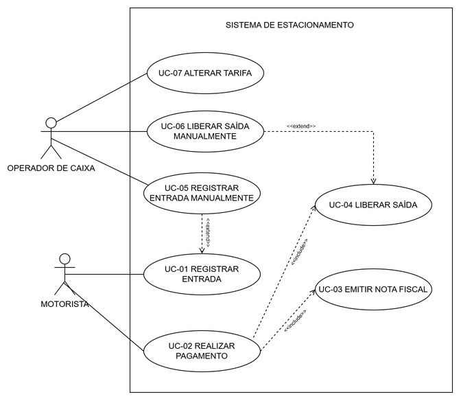

<!-- Representação textual equivalente (Mermaid):

```mermaid
flowchart LR
    C((Motorista))
    subgraph S[Sistema de Estacionamento]
        UC6([UC-06 Liberar Saída Manualmente])
        UC5([UC-05 Registrar Entrada Manualmente])
        UC1([UC-01 Registrar Entrada])
        UC2([UC-02 Realizar Pagamento])
        UC3([UC-03 Emitir Nota Fiscal])
        UC4([UC-04 Liberar Saída])
    end
    OP((Operador de Caixa))

    C --- UC1
    C --- UC2
    UC2 -. "&lt;&lt;include&gt;&gt;" .-> UC3
    UC2 -. "&lt;&lt;include&gt;&gt;" .-> UC4

    UC7([UC-07 Alterar Tarifa])
    OP --- UC7
    OP --- UC6
    OP --- UC5
    UC5 -. "&lt;&lt;extend&gt;&gt;" .-> UC1
    UC6 -. "&lt;&lt;extend&gt;&gt;" .-> UC4
```-->

**Descrição dos atores**

| Ator | Descrição | Casos de uso associados |
|---|---|---|
| Motorista | Pessoa que estaciona o veículo; pode ser avulso, pernoite ou mensalista. | UC-01 e UC-02 |
| Operador de Caixa | Funcionário que trata exceções (ticket não emitido, ticket perdido, horário de saída incorreto, tarifa errada) desbloqueando o totem com o seu código de autorização. Não altera o horário de entrada e não recebe pagamentos. | UC-05, UC-06 e UC-07 |
| Sistema | Sistema que libera a nota fiscal e a saída do estacionamento. | UC-03 e UC-04 |

**Lista de casos de uso**

| ID | Caso de uso | Ator(es) | Requisito(s) funcional(is) relacionado(s) |
|---|---|---|---|
| UC-01 | Registrar Entrada | Motorista | RF-01 |
| UC-02 | Realizar Pagamento | Motorista | RF-02, RF-03, RF-05, RF-08 |
| UC-03 | Emitir Nota Fiscal (`<<include>>` de UC-02) | Sistema | RF-04 |
| UC-04 | Liberar Saída (`<<include>>` de UC-02) | Sistema | RF-06 |
| UC-05 | Registrar Entrada Manualmente (`<<extend>>` de UC-01) | Operador de Caixa | RF-09, RF-10 |
| UC-06 | Liberar Saída Manualmente (`<<extend>>` de UC-04) | Operador de Caixa | RF-07, RF-10 |
| UC-07 | Alterar Tarifa | Operador de Caixa | RF-11, RF-10 |

---

### 6.2 Visão arquitetural
O sistema adota a arquitetura **monolítica em camadas**: todas as camadas são compiladas e executadas em **um único processo**, comunicando-se por chamadas diretas de método (sem rede entre elas).

- **Apresentação** — `Totem` (objeto de fronteira no diagrama de sequência): telas de entrada, pagamento e emissão de documentos.
- **Aplicação/Orquestração** — `EstacionamentoFacade`, que assume o papel exercido pelo objeto `Veiculo` no diagrama de sequência (coordena registro, consulta, cálculo, pagamento, NF e liberação).
- **Domínio** — `Ticket` (com seus estados), estratégias de `Tarifa`, `Pagamento`, `Comprovante`, `NF`.
- **Persistência** — `VeiculoDao` (registro de veículo/ticket, consulta e atualização).
- **Subsistema de cobrança** — `Cobranca` (processa o pagamento dentro do mesmo processo).

### 6.3 Diagrama de arquitetura (visão geral)

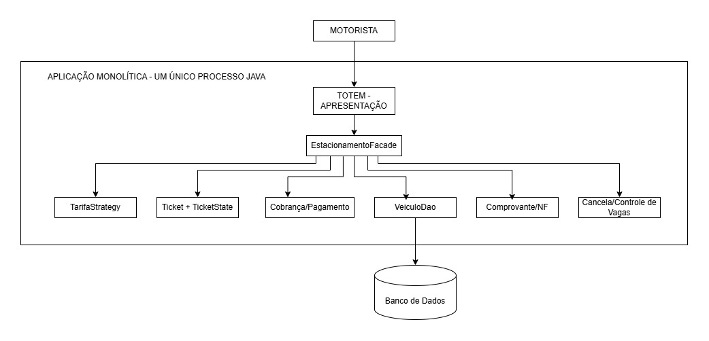

<div style="display: none;">
```mermaid
flowchart TD
    M[Motorista] --> T
    subgraph MONO[Aplicação monolítica - um único processo Java]
        T[Totem - Apresentação]
        F[EstacionamentoFacade]
        TK[Ticket + TicketState]
        TS[TarifaStrategy]
        CB[Cobranca / Pagamento]
        DOC[Comprovante / NF]
        DAO[VeiculoDao]
        CAN[Cancela / Controle de vagas]
        T --> F
        F --> TK
        F --> TS
        F --> CB
        F --> DOC
        F --> DAO
        F --> CAN
    end
    DAO --> DB[(Banco de Dados)]
```
</div>

### 6.4 Componentes / Módulos

| Componente | Responsabilidade | Tecnologia |
|---|---|---|
| Totem (UI) | Entrada de dados, exibição de valores, impressão de ticket/comprovante/NF | Java + JavaFX (telas FXML) |
| EstacionamentoFacade | Ponto único de entrada das operações de entrada, pagamento e saída | Java |
| Ticket / TicketState | Ciclo de vida do ticket e regras de transição | Java |
| TarifaStrategy | Cálculo do valor por perfil/regra | Java |
| Cobranca / Pagamento | Validação do pagamento em dinheiro (valor recebido e troco) e registro | Java |
| Comprovante / NF | Emissão de documentos | Java |
| VeiculoDao | Persistência de veículos, tickets e pagamentos | Java + JDBC |
| Banco de Dados | Armazenamento persistente | H2 embutido (arquivo `./dados`) |

### 6.5 Stack tecnológica

| Camada | Tecnologia / Ferramenta | Versão |
|---|---|---|
| Front-end (totem) | Java + JavaFX (FXML) | Java 21 (compatível com JDK 25); JavaFX 21.0.1 |
| Back-end | Java (mesmo processo do front-end) | Java 21 |
| Banco de Dados | H2 embutido via JDBC | H2 2.2.224 |
| Testes | JUnit 5 + Mockito | JUnit 5.11.4; Mockito 5.20.0 |
| Build | Maven (NetBeans) | Maven 3 |
| Infraestrutura / CI/CD | Máquina local do totem | — |

### 6.6 Modelo de dados

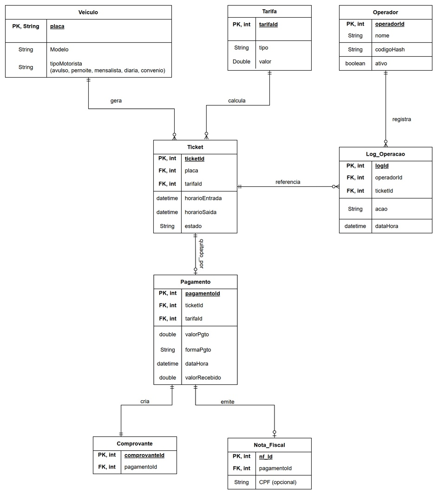

<div style="display: none;">
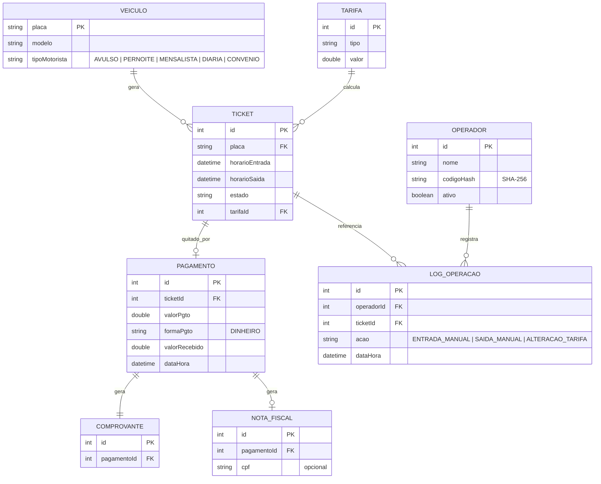
</div>

### 6.7 Diagrama de classes

**6.7.1 Diagrama original (draw.io)**

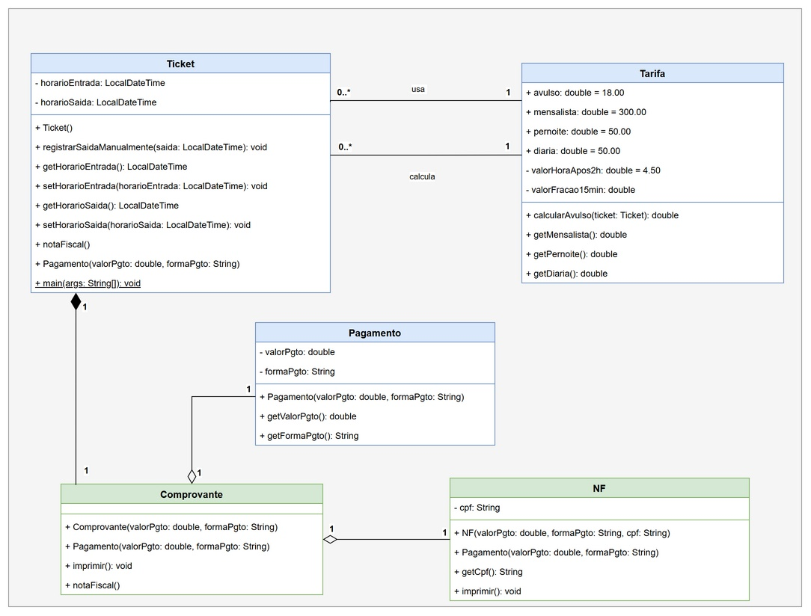

<div style="display: none;">
Representação equivalente em Mermaid:
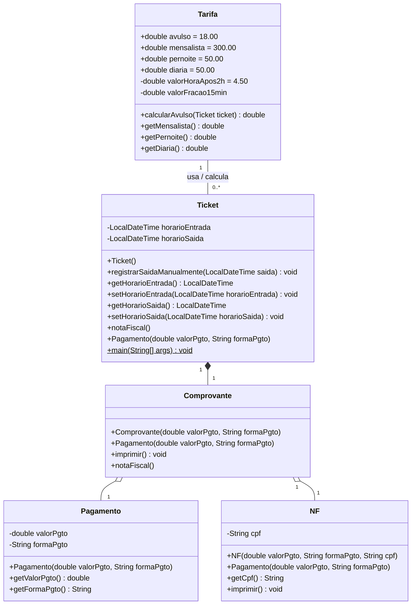
</div>

**6.7.2 Diagrama completo (domínio + classes do diagrama de sequência + padrões GoF)**

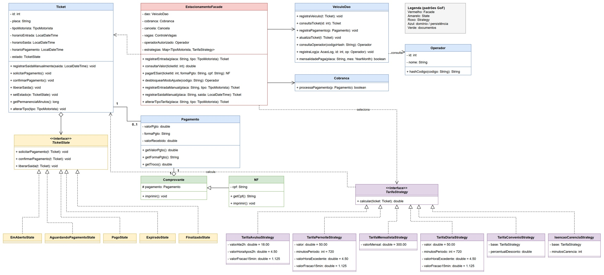

<div style="display: none;">
```mermaid
classDiagram
    class EstacionamentoFacade {
        -VeiculoDao dao
        -Cobranca cobranca
        -Cancela cancela
        -ControleVagas vagas
        +registrarEntrada(String placa, TipoMotorista tipo) Ticket
        +consultarValor(int ticketId) double
        +pagarESair(int ticketId, String formaPgto, String cpf) NF
        +desbloquearModoAjuste(String codigo) Operador
        +registrarEntradaManual(String placa, TipoMotorista tipo) Ticket
        +registrarSaidaManual(String placa, LocalDateTime saida) Ticket
        +alterarTipoTarifa(String placa, TipoMotorista tipo) Ticket
    }
    class Ticket {
        -int id
        -String placa
        -TipoMotorista tipoMotorista
        -LocalDateTime horarioEntrada
        -LocalDateTime horarioSaida
        -LocalDateTime horarioPagamento
        -TicketState estado
        +registrarSaidaManualmente(LocalDateTime saida) void
        +solicitarPagamento() void
        +confirmarPagamento() void
        +liberarSaida() void
        +setEstado(TicketState e) void
        +getPermanenciaMinutos() long
        +alterarTipo(TipoMotorista tipo) void
    }
    class TicketState {
        <<interface>>
        +solicitarPagamento(Ticket t) void
        +confirmarPagamento(Ticket t) void
        +liberarSaida(Ticket t) void
    }
    class EmAbertoState
    class AguardandoPagamentoState
    class PagoState
    class ExpiradoState
    class FinalizadoState
    class TarifaStrategy {
        <<interface>>
        +calcular(Ticket ticket) double
    }
    class TarifaAvulsaStrategy {
        -double valorAte2h = 18.00
        -double valorHoraApos2h = 4.50
        -double valorFracao15min = 1.125
    }
    class TarifaPernoiteStrategy {
        -double valor = 50.00
        -int minutosPeriodo = 720
        -double valorHoraExcedente = 4.50
        -double valorFracao15min = 1.125
    }
    class TarifaMensalistaStrategy {
        -double valorMensal = 300.00
    }
    class TarifaDiariaStrategy {
        -double valor = 50.00
        -int minutosPeriodo = 720
        -double valorHoraExcedente = 4.50
        -double valorFracao15min = 1.125
    }
    class TarifaConvenioStrategy {
        -double percentualDesconto
    }
    class IsencaoCarenciaStrategy {
        -int minutosCarencia
    }
    class Pagamento {
        -double valorPgto
        -String formaPgto
        -double valorRecebido
        +getTroco() double
        +getValorPgto() double
        +getFormaPgto() String
    }
    class Comprovante {
        #Pagamento pagamento
        +imprimir() void
    }
    class NF {
        -String cpf
        +getCpf() String
        +imprimir() void
    }
    class Cobranca {
        +processaPagamento(Pagamento p) boolean
    }
    class VeiculoDao {
        +registraVeiculo(Ticket t) void
        +consultaTicket(int id) Ticket
        +registraPagamento(Pagamento p) void
        +atualizaTicket(Ticket t) void
        +consultaOperador(String codigoHash) Operador
        +registraLog(AcaoLog a, int ticketId, Operador op) void
        +mensalidadePaga(String placa, YearMonth mes) boolean
    }
    class Operador {
        -int id
        -String nome
        +hashCodigo(String codigo)$ String
    }

    VeiculoDao ..> Operador : consulta
    EstacionamentoFacade --> VeiculoDao
    EstacionamentoFacade --> Cobranca
    EstacionamentoFacade ..> TarifaStrategy : seleciona
    EstacionamentoFacade ..> Ticket
    Ticket o--> TicketState
    TicketState <|.. EmAbertoState
    TicketState <|.. AguardandoPagamentoState
    TicketState <|.. PagoState
    TicketState <|.. ExpiradoState
    TicketState <|.. FinalizadoState
    TarifaStrategy <|.. TarifaAvulsaStrategy
    TarifaStrategy <|.. TarifaPernoiteStrategy
    TarifaStrategy <|.. TarifaMensalistaStrategy
    TarifaStrategy <|.. TarifaDiariaStrategy
    TarifaStrategy <|.. TarifaConvenioStrategy
    TarifaStrategy <|.. IsencaoCarenciaStrategy
    TarifaStrategy ..> Ticket : calcula
    Ticket "1" -- "0..1" Pagamento
    Comprovante "1" o-- "1" Pagamento
    Comprovante <|-- NF
``
</div>


**Descrição das principais classes**

| Classe | Responsabilidade | Requisito(s) relacionado(s) |
|---|---|---|
| Ticket | Registra entrada/saída, permite trocar a tarifa (sem alterar a entrada) e delega as transições ao estado atual. | RF-01, RF-06, RF-07, RF-11, RN-05, RN-06, RN-10, RN-11 |
| TicketState e estados concretos | Definem o que é permitido em cada fase do ticket. | RF-06, RN-05, RN-06, RN-11 |
| Tarifa / TarifaStrategy e concretas | Calculam o valor devido conforme o perfil e a regra. | RF-02, RF-08, RN-01 a RN-04, RN-07, RN-08 |
| Pagamento | Guarda valor e forma de pagamento. | RF-03 |
| Comprovante | Imprime o comprovante do pagamento. | RF-05, RN-09 |
| NF | Nota fiscal com CPF opcional. | RF-04, RN-09 |
| EstacionamentoFacade | Orquestra entrada, cálculo, pagamento, NF e liberação. | RF-01 a RF-06 |
| Cobranca | Valida o pagamento em dinheiro (valor recebido ≥ valor devido). | RF-03, RN-14 |
| VeiculoDao | Persistência de tickets, pagamentos, documentos, operadores e log. | RF-01, RF-02, RF-06, RN-12 |
| Operador | Operador de Caixa identificado pelo código de autorização (guardado só como hash SHA-256). | RF-10, RN-12 |


### 6.8 Diagrama de sequência

**Diagrama de sequência — UC-01 a UC-07 (RF-01 a RF-11): entrada, cálculo, pagamento em dinheiro, NF, liberação da saída e ações do Operador de Caixa (desbloqueio, entrada manual com horário do sistema, ajuste de saída e alteração de tarifa)**

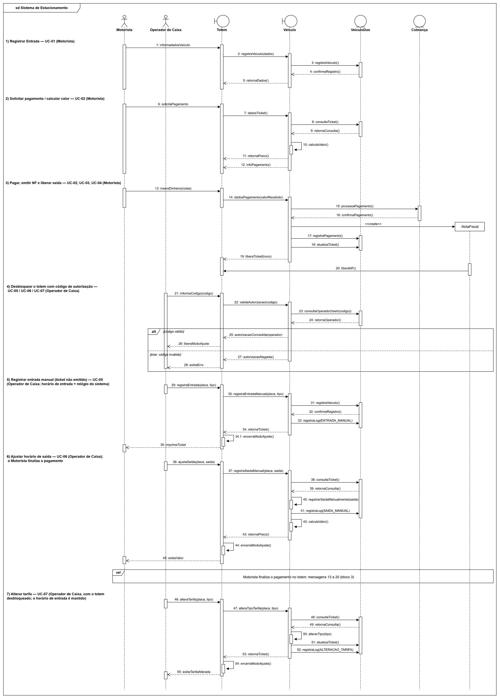

<div style="display: none;">
Representação equivalente em Mermaid:
```mermaid
sequenceDiagram
    actor M as Motorista
    participant T as Totem
    participant V as Veiculo (EstacionamentoFacade)
    participant D as VeiculoDao
    participant C as Cobrança

    Note over M,C: Registrar entrada — UC-01 / RF-01
    M->>T: 1: informadadosVeiculo
    T->>V: 2: registraVeiculo(dados)
    V->>D: 3: registraVeiculo()
    D-->>V: 4: confirmaRegistro()
    V-->>T: 5: retornaDados()

    Note over M,C: Calcular valor — UC-02 / RF-02
    M->>T: 6: solicitaPagamento
    T->>V: 7: dadosTicket()
    V->>D: 8: consultaTicket()
    D-->>V: 9: retornaConsulta()
    V->>V: 10: calculaValor()
    V-->>T: 11: retornaPreco()
    V-->>T: 12: infoPagamento()

    Note over M,C: Pagar, emitir NF e liberar saída — UC-02, UC-03, UC-04 / RF-03, RF-04, RF-06
    M->>T: 13: insereDinheiro(notas)
    T->>V: 14: dadosPagamento(valorRecebido)
    V->>C: 15: processaPagamento()
    C-->>V: 16: confirmaPagamento()
    create participant NF as :NotaFiscal
    V->>NF: <<create>>
    V->>D: 17: registraPagamento()
    V->>D: 18: atualizaTicket()
    V-->>T: 19: liberaTicket(troco)
    NF->>T: 20: liberaNF()
``
</div>

> Observação: o passo 10 `calculaValor()` é onde a Facade aplica a `TarifaStrategy`; os passos 7, 16 e 18 correspondem às transições de estado do ticket (Em Aberto → Aguardando Pagamento → Pago).

---

### 6.9 Padrões de projeto (GoF) utilizados

| Padrão GoF | Categoria | Problema que resolve no projeto | Classes / arquivos envolvidos |
|---|---|---|---|
| Strategy | Comportamental | Elimina cadeias de `if/else` no cálculo do valor por tempo e perfil; novas tarifas sem alterar o caixa. | `TarifaStrategy`, `TarifaAvulsaStrategy`, `TarifaPernoiteStrategy`, `TarifaMensalistaStrategy`, `TarifaDiariaStrategy` (R$ 50 por 12 h + excedente), `TarifaConvenioStrategy`, `IsencaoCarenciaStrategy` |
| State | Comportamental | Garante transições rígidas do ticket e impede a abertura da cancela em estados inválidos. | `Ticket`, `TicketState`, `EmAbertoState`, `AguardandoPagamentoState`, `PagoState`, `ExpiradoState`, `FinalizadoState` |
| Facade | Estrutural | Oferece uma única operação para totem/app/caixa, escondendo a coordenação de ticket, tarifa, pagamento, NF, cancela e vagas. | `EstacionamentoFacade`, `VeiculoDao`, `Cobranca`, `NF`, `Cancela`, `ControleVagas` |

#### Padrão 1 — Strategy

- **Categoria:** Comportamental
- **Intenção do padrão:** definir uma família de algoritmos, encapsular cada um em uma classe e torná-los intercambiáveis, para que o algoritmo varie independentemente de quem o usa.
- **Motivação / contexto no projeto:** o valor a pagar depende do perfil e da regra (avulso por hora, diária, mensalista, pernoite, convênio de loja, isenção por carência). Na versão atual, `Tarifa.calcularAvulso()` concentra tudo e cresceria em `if/else`. Com Strategy, criar uma tarifa de fim de semana ou feriado é criar uma nova classe, sem alterar a lógica do caixa.
- **Alternativas consideradas:** `switch` por tipo de Motorista dentro de `Tarifa` — mais simples no início, mas viola o princípio aberto/fechado e dificulta testar cada regra isoladamente.
- **Participantes (mapeamento para o projeto):**

  | Papel no padrão | Classe no projeto |
  |---|---|
  | Context | `EstacionamentoFacade` (seleciona e usa a estratégia) |
  | Strategy | `TarifaStrategy` |
  | ConcreteStrategy | `TarifaAvulsaStrategy`, `TarifaPernoiteStrategy`, `TarifaMensalistaStrategy`, `TarifaDiariaStrategy`, `TarifaConvenioStrategy`, `IsencaoCarenciaStrategy` |

- **Diagrama de classes do padrão:**
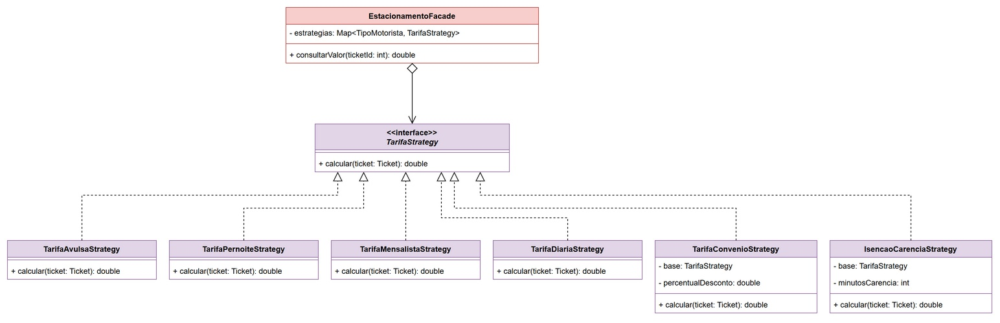

<div style="display: none;">
```mermaid
classDiagram
    class EstacionamentoFacade {
        -Map~TipoMotorista, TarifaStrategy~ estrategias
        +consultarValor(int ticketId) double
    }
    class TarifaStrategy {
        <<interface>>
        +calcular(Ticket ticket) double
    }
    class TarifaAvulsaStrategy {
        +calcular(Ticket ticket) double
    }
    class TarifaPernoiteStrategy {
        +calcular(Ticket ticket) double
    }
    class TarifaMensalistaStrategy {
        +calcular(Ticket ticket) double
    }
    class TarifaDiariaStrategy {
        +calcular(Ticket ticket) double
    }
    class TarifaConvenioStrategy {
        -TarifaStrategy base
        -double percentualDesconto
        +calcular(Ticket ticket) double
    }
    class IsencaoCarenciaStrategy {
        -TarifaStrategy base
        -int minutosCarencia
        +calcular(Ticket ticket) double
    }
    EstacionamentoFacade o--> TarifaStrategy
    TarifaStrategy <|.. TarifaAvulsaStrategy
    TarifaStrategy <|.. TarifaPernoiteStrategy
    TarifaStrategy <|.. TarifaMensalistaStrategy
    TarifaStrategy <|.. TarifaDiariaStrategy
    TarifaStrategy <|.. TarifaConvenioStrategy
    TarifaStrategy <|.. IsencaoCarenciaStrategy
``
</div>

- **Trecho de código ilustrativo:**

```java
public interface TarifaStrategy {
    double calcular(Ticket ticket);
}

public class TarifaAvulsaStrategy implements TarifaStrategy {
    private static final double VALOR_ATE_2H = 18.00;          // RN-01
    private static final double VALOR_FRACAO_15MIN = 4.50 / 4;  // RN-02

    @Override
    public double calcular(Ticket ticket) {
        long minutos = ticket.getPermanenciaMinutos();
        if (minutos <= 120) return VALOR_ATE_2H;
        long fracoes = (long) Math.ceil((minutos - 120) / 15.0);
        double total = VALOR_ATE_2H + fracoes * VALOR_FRACAO_15MIN;
        return Math.round(total * 100) / 100.0;
    }
}

public class IsencaoCarenciaStrategy implements TarifaStrategy {
    private final TarifaStrategy base;
    private final int minutosCarencia;
    public IsencaoCarenciaStrategy(TarifaStrategy base, int minutosCarencia) {
        this.base = base; this.minutosCarencia = minutosCarencia;
    }
    @Override
    public double calcular(Ticket ticket) {                       // RN-07
        return ticket.getPermanenciaMinutos() <= minutosCarencia ? 0.0 : base.calcular(ticket);
    }
}
```

- **Benefícios obtidos e consequências (trade-offs):** cada regra fica isolada e testável; novas tarifas não alteram o código existente. Em troca, há mais classes e é preciso uma regra clara para escolher a estratégia (feita pela Facade conforme o perfil do ticket).

#### Padrão 2 — State

- **Categoria:** Comportamental
- **Intenção do padrão:** permitir que um objeto altere seu comportamento quando o seu estado interno muda.
- **Motivação / contexto no projeto:** o ticket passa por Em Aberto → Aguardando Pagamento → Pago → Finalizado, podendo ir para Expirado se o motorista demorar além da tolerância após pagar. Cada estado decide o que é permitido: só `PagoState` (dentro do prazo) libera a cancela; `PagoState` recusa um segundo pagamento; `ExpiradoState` exige cobrança complementar.
- **Alternativas consideradas:** um atributo `String status` com `if` em cada método — as regras de transição ficariam espalhadas e seria fácil esquecer uma verificação e abrir a cancela indevidamente.
- **Participantes (mapeamento para o projeto):**

  | Papel no padrão | Classe no projeto |
  |---|---|
  | Context | `Ticket` |
  | State | `TicketState` |
  | ConcreteState | `EmAbertoState`, `AguardandoPagamentoState`, `PagoState`, `ExpiradoState`, `FinalizadoState` |

- **Diagrama de estados (transições):**
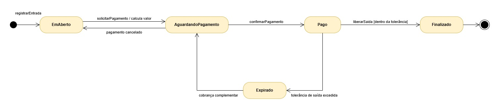

<div style="display: none;">
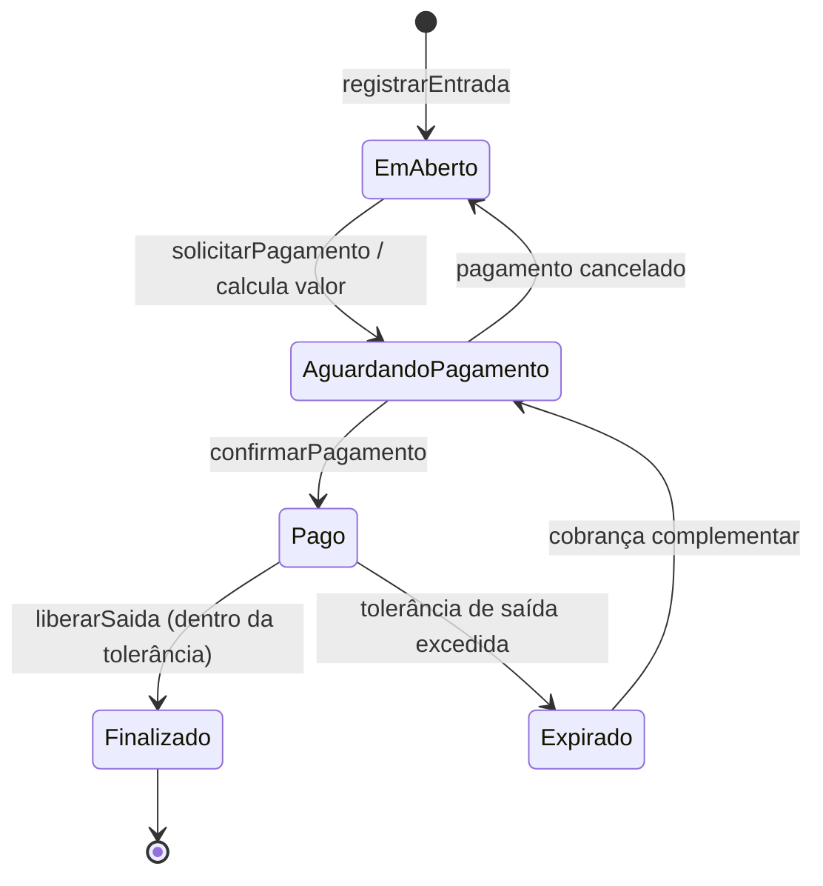
</div>

- **Diagrama de classes do padrão:**
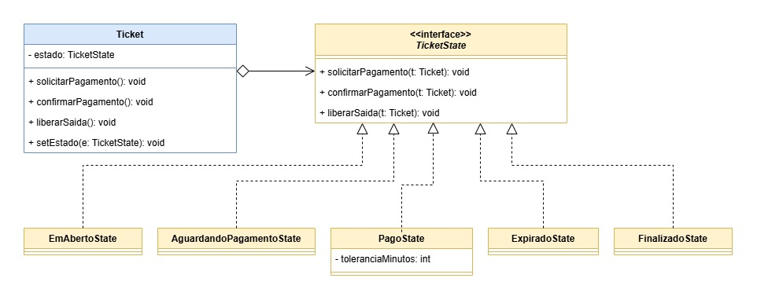

<div style="display: none;">
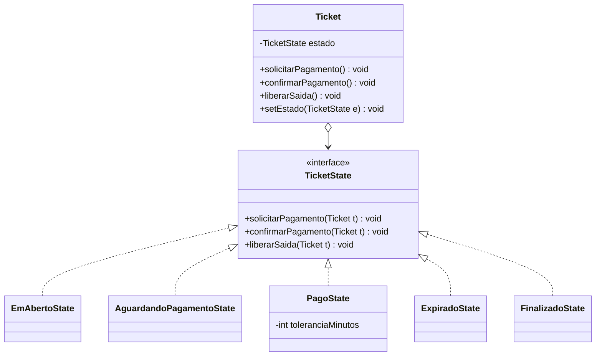
</div>

- **Trecho de código ilustrativo:**

```java
public class EmAbertoState implements TicketState {
    @Override public void solicitarPagamento(Ticket t) { t.setEstado(new AguardandoPagamentoState()); }
    @Override public void confirmarPagamento(Ticket t) { throw new IllegalStateException("Calcule o valor antes de pagar."); }
    @Override public void liberarSaida(Ticket t)      { throw new IllegalStateException("Ticket em aberto: pagamento pendente."); } // RN-05
}

public class PagoState implements TicketState {
    private static final int TOLERANCIA_MIN = 15;                 // RN-06 (a definir)
    @Override public void confirmarPagamento(Ticket t) { throw new IllegalStateException("Ticket já pago."); } // RN-11
    @Override public void liberarSaida(Ticket t) {
        long min = Duration.between(t.getHorarioPagamento(), LocalDateTime.now()).toMinutes();
        if (min > TOLERANCIA_MIN) {
            t.setEstado(new ExpiradoState());
            throw new IllegalStateException("Tempo de saída excedido. Pague o valor adicional.");
        }
        t.setHorarioSaida(LocalDateTime.now());
        t.setEstado(new FinalizadoState());
    }
    @Override public void solicitarPagamento(Ticket t) { throw new IllegalStateException("Ticket já pago."); }
}
```

- **Benefícios obtidos e consequências (trade-offs):** transições explícitas e seguras; cada estado é testado isoladamente; novos estados (ex.: "Ticket Perdido") são acrescentados sem alterar os demais. Em troca, mais classes e a necessidade de persistir o nome do estado no banco.

#### Padrão 3 — Facade

- **Categoria:** Estrutural
- **Intenção do padrão:** oferecer uma interface única e simplificada para um conjunto de interfaces de um subsistema.
- **Motivação / contexto no projeto:** pagar e sair exige consultar o ticket, aplicar a estratégia de tarifa, processar o pagamento, emitir comprovante e NF, registrar a baixa, liberar a cancela e atualizar a contagem de vagas. No diagrama de sequência, essa coordenação já é feita pelo objeto `Veiculo`; a `EstacionamentoFacade` formaliza esse papel, de modo que totem, app ou operador de caixa chamem uma única operação (`pagarESair`).
- **Alternativas consideradas:** o totem chamar cada subsistema diretamente — duplicaria a orquestração em cada interface (totem, app, caixa) e acoplaria a UI a todas as classes internas.
- **Participantes (mapeamento para o projeto):**

  | Papel no padrão | Classe no projeto |
  |---|---|
  | Facade | `EstacionamentoFacade` (papel do `Veiculo` no diagrama de sequência) |
  | Subsistemas | `VeiculoDao`, `Ticket`/`TicketState`, `TarifaStrategy`, `Cobranca`, `Comprovante`, `NF`, `Cancela`, `ControleVagas` |
  | Motoristas | `Totem`, app, operador de caixa |

- **Diagrama de classes do padrão:**
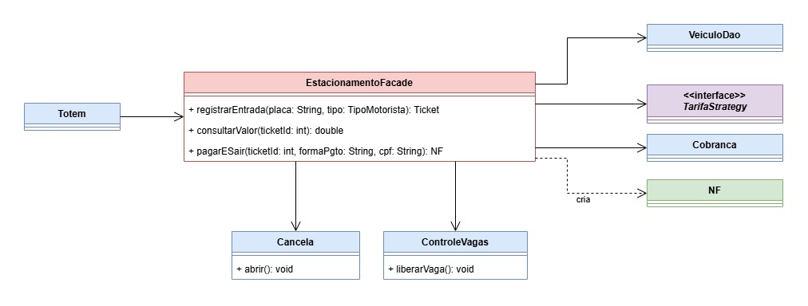

<div style="display: none;">
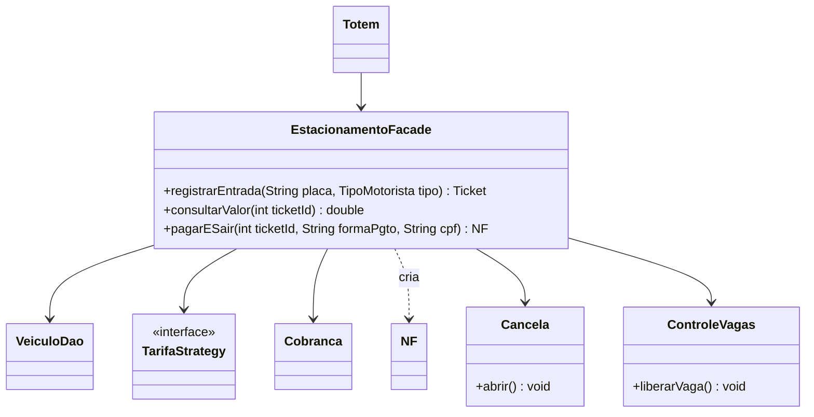
</div>

- **Trecho de código ilustrativo:**

```java
public class EstacionamentoFacade {
    private final VeiculoDao dao;
    private final Cobranca cobranca;
    private final Cancela cancela;
    private final ControleVagas vagas;
    private final Map<TipoMotorista, TarifaStrategy> estrategias;

    public NF pagarESair(int ticketId, String formaPgto, Double valorRecebido, String cpf) {
        Ticket ticket = dao.consultaTicket(ticketId);                       // passo 8
        NF.validarCpf(cpf);                                                 // CPF inválido é recusado antes de cobrar
        ticket.solicitarPagamento();                                        // Em Aberto -> Aguardando
        double valor = estrategias.get(ticket.getTipoMotorista()).calcular(ticket); // passo 10 (Strategy)
        Pagamento pgto = new Pagamento(ticket, valor, formaPgto, valorRecebido);    // somente dinheiro
        if (!cobranca.processaPagamento(pgto)) {                            // passos 15-16
            throw new PagamentoRecusadoException("Pagamento recusado.");
        }
        ticket.confirmarPagamento();                                        // -> Pago (State)
        NF nf = new NF(pgto, cpf);                                          // <<create>>
        dao.registraPagamento(pgto);                                        // passo 17
        dao.registraNotaFiscal(nf);
        ticket.liberarSaida();                                              // Pago -> Finalizado (State, RN-05)
        dao.atualizaTicket(ticket);                                         // passo 18
        cancela.abrir();                                                    // passo 19
        vagas.liberarVaga();
        return nf;                                                          // passo 20
    }
}
```

- **Benefícios obtidos e consequências (trade-offs):** a interface (totem/app/caixa) depende de uma única classe; a ordem correta das etapas fica garantida em um só lugar. Em troca, a Facade pode crescer demais ("god class") se acumular regras — por isso o cálculo fica nas Strategies e as transições no State.

---

### 6.10 Decisões de arquitetura (ADR resumido)

| ID | Decisão | Contexto | Alternativas consideradas | Justificativa |
|---|---|---|---|---|
| ADR-01 | Arquitetura monolítica em camadas | Um totem/caixa local, equipe pequena, escopo acadêmico | Motorista/servidor ou microsserviços | Simplicidade de implantação, depuração e testes; sem latência de rede |
| ADR-02 | Strategy para tarifas | Tabela de preços muda com frequência | `switch` em `Tarifa` | Extensibilidade sem alterar o caixa |
| ADR-03 | State para o ticket | Cancela não pode abrir em estado inválido | Campo `status` com `if` | Transições centralizadas e seguras |
| ADR-04 | Facade como ponto único de entrada | Totem, app e caixa executam as mesmas operações | Orquestração na UI | Evita duplicação e acoplamento |
| ADR-05 | Acesso a dados via DAO | Separar regras de SQL | SQL direto nas classes de domínio | Testabilidade com mocks |

### 6.11 Estrutura de pastas do projeto

```
/Estacionamento (projeto Maven)
  pom.xml
  /src/main/java/estacionamento
    App.java                 (main)
    /ui                      Totem (JavaFX) e controllers das telas: TelaInicial, Atendimento, TipoCliente,
                             Ticket, TipoTarifa, FormaPagamento, Nota, Comprovante, Final, Operador, Ajuste
    /facade                  EstacionamentoFacade, PagamentoRecusadoException, AutorizacaoNegadaException
    /domain                  Ticket, Pagamento, Comprovante, NF, Operador, TipoMotorista, AcaoLog
    /domain/estado           TicketState, EmAbertoState, AguardandoPagamentoState, PagoState, ExpiradoState, FinalizadoState
    /domain/tarifa           TarifaStrategy, TarifaAvulsaStrategy, TarifaPernoiteStrategy, TarifaMensalistaStrategy,
                             TarifaDiariaStrategy, TarifaConvenioStrategy, IsencaoCarenciaStrategy
    /service                 Cobranca, Cancela, ControleVagas
    /dao                     VeiculoDao, DaoException
  /src/main/resources/estacionamento/ui/view
                             telas .fxml e imagens do totem
  /src/test/java/estacionamento
    TarifaAvulsaStrategyTest, TicketStateTest, EstacionamentoFacadeTest, NFTest, VeiculoDaoTest, TicketFactory
  /dados                     banco H2 (criado na primeira execução)
/docs
  Documentacao_Monolitico_Estacionamento.md
  /imagens
```

### 6.12 Integrações externas

| Sistema externo | Finalidade | Protocolo | Observações |
|---|---|---|---|
| Banco de dados | Persistência de tickets e pagamentos | JDBC/SQL | Acessado pelo `VeiculoDao` |
| Cancela / sensores | Abertura da cancela | Driver local | Simulado no projeto |
| Impressora do totem | Ticket, comprovante e NF | Driver local | Simulada |
| Meio de pagamento | Recebimento de dinheiro no totem | — | Sem APIs externas: somente dinheiro, validado em `Cobranca` (RN-14) |

---

## 7. Plano e Casos de Teste

### 7.1 Estratégia de testes
- **Unitários (JUnit 5):** estratégias de tarifa, estados do ticket e documentos (NF).
- **Unitários com mocks (Mockito):** `EstacionamentoFacade` com `VeiculoDao`, `Cobranca` e `Cancela` simulados.
- **Integração:** Facade + DAO com banco de teste.
- **Sistema/aceitação:** fluxo completo no totem (CT-XX).
- **Ferramentas:** JUnit 5, Mockito, JaCoCo, Maven/Gradle.

**Testes unitários com JUnit (3+ classes):**

| Classe testada | Classe de teste (JUnit) | Cenários cobertos | Requisito(s) / Regra(s) relacionado(s) | Resultado |
|---|---|---|---|---|
| `TarifaAvulsaStrategy` (e demais estratégias) — cálculo do valor | `TarifaAvulsaStrategyTest` | `@ParameterizedTest` com `@CsvSource`: 30 min → 18,00; 120 min (limite) → 18,00; 121 min → 19,13; 150 min → 20,25; 180 min → 22,50; carência de 10 min → 0,00; pernoite e diária: 720 min → 50,00, 721 min → 51,13, 960 min (16 h) → 68,00; mensalista → 300,00 / 0,00 com o mês pago; convênio −10% | RF-02, RF-08, RN-01 a RN-04, RN-07, RN-08, RN-13, RNF-02 | Aprovado |
| `Ticket` + estados — ciclo de vida | `TicketStateTest` | Novo ticket em `EmAbertoState`; liberar saída em aberto lança `IllegalStateException` (`assertThrows`); fluxo completo até `FinalizadoState` (`assertInstanceOf`); pagar duas vezes é recusado; saída após tolerância leva a `ExpiradoState`; saída anterior à entrada é recusada | RF-06, RF-07, RN-05, RN-06, RN-10, RN-11 | Aprovado |
| `EstacionamentoFacade` — orquestração | `EstacionamentoFacadeTest` | Pagamento aprovado: `verify(dao).registraPagamento`, `verify(cancela).abrir()`; pagamento recusado: `verify(cancela, never()).abrir()` e ticket não fica Pago; estratégia correta escolhida pelo perfil; ações do operador (código inválido, entrada manual, ajuste de saída, alteração de tarifa). `@Mock`, `@InjectMocks`, `@BeforeEach` | RF-03, RF-04, RF-06, RF-07, RF-09 a RF-11, RN-05, RN-09, RN-12 | Aprovado |
| `NF` — nota fiscal | `NFTest` | NF com CPF válido; NF sem CPF (CPF `null` permitido); CPF inválido lança exceção; valores herdados do pagamento; dinheiro com troco; forma diferente de dinheiro recusada | RF-04, RN-09, RN-14, RNF-L02 | Aprovado |
| `VeiculoDao` + Facade — integração com banco H2 em memória | `VeiculoDaoTest` | Ticket persistido e recuperado; estado persistido; operador pelo hash; mensalidade uma vez por mês; fluxo completo com alteração de tarifa, pagamento em dinheiro, NF e log | RF-01, RF-06, RF-11, RN-03, RN-12, RNF-03 | Aprovado |

**Recursos do JUnit utilizados:** `@Test`, `@BeforeEach`, `@DisplayName`, `@ParameterizedTest` com `@CsvSource`, `assertEquals` (com delta), `assertThrows`, `assertInstanceOf`, `assertNull`; Mockito com `@ExtendWith(MockitoExtension.class)`, `@Mock`, `@InjectMocks`, `when(...).thenReturn(...)`, `verify(...)` e `never()`.

**Exemplo:**

```java
class TarifaAvulsaStrategyTest {
    private final TarifaStrategy tarifa = new TarifaAvulsaStrategy();

    @ParameterizedTest(name = "{0} min -> R$ {1}")
    @CsvSource({ "30, 18.00", "120, 18.00", "121, 19.13", "150, 20.25", "180, 22.50" })
    @DisplayName("CT-03/CT-04 - tarifa avulsa por tempo de permanência")
    void calculaAvulso(long minutos, double esperado) {
        Ticket t = TicketFactory.comPermanencia(minutos);
        assertEquals(esperado, tarifa.calcular(t), 0.001);
    }
}

class TicketStateTest {
    @Test
    @DisplayName("CT-09 - cancela não abre com ticket em aberto")
    void naoLiberaTicketEmAberto() {
        Ticket t = new Ticket("ABC1D23", TipoMotorista.AVULSO);
        assertThrows(IllegalStateException.class, t::liberarSaida);
    }
}
```

**Execução:** `mvn test` (ou pela IDE: *Run Tests*). **Resultado em 21/11/2026: 85 testes, 85 aprovados, 0 reprovados** (`EstacionamentoFacadeTest` 21, `TarifaAvulsaStrategyTest` 32, `TicketStateTest` 16, `NFTest` 11, `VeiculoDaoTest` 5). **Cobertura (JaCoCo 0.8.13, relatório em `target/site/jacoco/index.html`):**

| Pacote | Linhas cobertas | Desvios (if/else) cobertos |
|---|---|---|
| `domain` | 90% (169/188) | 77% |
| `domain.estado` | 88% (57/65) | 88% |
| `domain.tarifa` | 80% (47/59) | 92% |
| `facade` | 86% (114/133) | 75% |
| `dao` | 82% (143/174) | 94% |
| `service` | 66% (21/32) | 57% |
| `ui` (telas JavaFX) | 0% (sem testes automatizados; verificadas pelos casos CT-XX no totem) | 0% |

Classes de domínio (`domain`, `domain.estado` e `domain.tarifa`): **88% das linhas (273/312)** — atende ao RNF-06 (≥ 70%). Sem a camada de telas, a cobertura do sistema é de 85% das linhas.

### 7.2 Ambientes de teste

| Ambiente | Finalidade | URL / Acesso |
|---|---|---|
| Desenvolvimento | Testes unitários na máquina do desenvolvedor | IDE / `mvn test` |
| Homologação (QA) | Teste do fluxo completo com banco de teste | Aplicação local + banco de teste |
| Produção | Totem do estacionamento | [não aplicável no projeto acadêmico] |

### Convenção de ID
`CT-XX` (Caso de Teste número XX)

### 7.3 Casos de Teste

| ID | Requisito relacionado | Descrição / Cenário | Pré-condições | Passos | Resultado esperado | Status |
|---|---|---|---|---|---|---|
| CT-01 | RF-01 | Registrar entrada | Vaga disponível | 1. Informar placa no totem | Ticket Em Aberto com horário de entrada | A executar |
| CT-02 | RF-01, RN-10 | Entrada duplicada | Veículo já com ticket aberto | 1. Informar a mesma placa | Novo ticket recusado | A executar |
| CT-03 | RF-02, RN-01 | Avulso até 2 h (inclusive limite de 120 min) | Ticket com 30 min / 120 min | 1. Solicitar pagamento | R$ 18,00 | A executar |
| CT-04 | RF-02, RN-02 | Avulso acima de 2 h | Ticket com 150 min / 180 min | 1. Solicitar pagamento | R$ 20,25 / R$ 22,50 | A executar |
| CT-05 | RF-08, RN-04 | Pernoite | Ticket de pernoite com 10 h / 16 h | 1. Solicitar pagamento | R$ 50,00 / R$ 68,00 (excedente de 4 h em frações de 15 min) | A executar |
| CT-06 | RF-08, RN-03 | Mensalista | Motorista mensalista com a mensalidade do mês já paga | 1. Solicitar saída | Sem cobrança (R$ 0,00); saída liberada | A executar |
| CT-07 | RF-02, RN-07 | Isenção por carência | Ticket dentro da carência | 1. Solicitar pagamento | R$ 0,00 | A executar |
| CT-08 | RF-03, RF-04, RF-05, RF-06 | Pagamento aprovado | Ticket Aguardando Pagamento | 1. Pagar 2. Informar CPF | Comprovante e NF emitidos; ticket Pago; cancela aberta | A executar |
| CT-09 | RF-06, RN-05 | Saída com ticket em aberto | Ticket Em Aberto | 1. Tentar sair | Cancela não abre; mensagem de pagamento pendente | A executar |
| CT-10 | RF-06, RN-06 | Saída após tolerância | Ticket Pago há mais de 15 min | 1. Tentar sair | Ticket Expirado; cobrança complementar | A executar |
| CT-11 | RF-03, RN-11 | Pagamento duplicado | Ticket Pago | 1. Pagar novamente | Operação recusada | A executar |
| CT-12 | RF-03 | Pagamento recusado | Ticket Aguardando Pagamento | 1. Pagamento falha | Ticket não muda para Pago; cancela fechada | A executar |
| CT-13 | RF-04, RNF-L02 | NF sem CPF | Pagamento aprovado | 1. Não informar CPF | NF emitida sem CPF | A executar |
| CT-14 | RF-07, RN-10 | Saída manual anterior à entrada | Ticket existente | 1. Informar saída < entrada | Exceção / mensagem de erro | A executar |
| CT-15 | RF-07, RF-10, RN-12 | Ajuste de saída pelo operador e pagamento pelo motorista | Ticket Em Aberto; operador com código válido | 1. Operador informa o código no totem 2. Ajusta o horário de saída 3. Motorista paga no totem | Valor recalculado; totem volta ao modo bloqueado; ticket Pago e Finalizado; cancela aberta; ajuste registrado em log | A executar |
| CT-16 | RF-09, RF-10, RN-12 | Entrada manual pelo operador | Ticket não emitido na entrada; operador com código válido | 1. Operador informa o código no totem 2. Informa placa e tipo de uso | Ticket Em Aberto criado com o horário do sistema e impresso; totem volta ao modo bloqueado; registro em log | A executar |
| CT-17 | RF-09, RN-10 | Entrada manual de placa com ticket em aberto | Veículo já com ticket aberto | 1. Operador informa a mesma placa | Novo ticket recusado | A executar |
| CT-18 | RF-03, RF-04, RF-05 | Pagamento em dinheiro no totem com troco | Ticket Aguardando Pagamento com valor de R$ 20,25 | 1. Motorista seleciona a forma de pagamento "Dinheiro" no totem 2. Insere R$ 50,00 | Troco de R$ 29,75 entregue; pagamento registrado; ticket Pago; comprovante e NF emitidos | A executar |
| CT-19 | RF-10, RN-12 | Código de autorização inválido | Totem em operação normal | 1. Informar um código de autorização inválido no totem | Mensagem de erro; totem continua bloqueado para ajustes; nenhum horário alterado | A executar |
| CT-20 | RF-11, RN-12 | Alteração de tarifa pelo operador | Ticket avulso Em Aberto; operador com código válido | 1. Operador informa o código 2. Digita a placa 3. Escolhe a nova tarifa | Horário de entrada exibido e inalterado; tarifa alterada; valor recalculado; registro `ALTERACAO_TARIFA` em log; totem bloqueado | A executar |
| CT-21 | RF-08, RN-13 | Diária | Ticket de diária com 10 h / 16 h | 1. Solicitar pagamento | R$ 50,00 / R$ 68,00 (excedente de 4 h em frações de 15 min) | A executar |
| CT-22 | RF-08, RN-03 | Mensalidade uma vez por mês | Mensalista sem pagamento no mês | 1. Primeira saída do mês 2. Nova entrada e saída no mesmo mês | 1ª saída: R$ 300,00; 2ª saída: R$ 0,00 | A executar |
| CT-23 | RF-03, RN-14 | Somente dinheiro | Ticket Aguardando Pagamento | 1. Tentar pagar com forma diferente de dinheiro | Pagamento recusado; o totem oferece apenas a inserção de notas | A executar |

---

## 8. Matriz de Rastreabilidade (Requisitos x Testes x Código-fonte)

> Objetivo: garantir que todo requisito tenha teste(s) associado(s) e implementação identificável no código-fonte, permitindo análise de cobertura e impacto de mudanças.

| Requisito (RF/RNF/RN) | Descrição resumida | Caso(s) de Teste | Arquivo(s) / Módulo de código | Status de implementação | Status de teste |
|---|---|---|---|---|---|
| RF-01 | Registrar entrada | CT-01, CT-02 | `facade/EstacionamentoFacade.java`, `dao/VeiculoDao.java`, `domain/Ticket.java` | Concluído | Aprovado (JUnit) |
| RF-02 | Calcular valor | CT-03, CT-04, CT-07 | `domain/tarifa/*Strategy.java` | Concluído | Aprovado (JUnit) |
| RF-03 | Realizar pagamento (somente dinheiro) | CT-08, CT-11, CT-12, CT-18, CT-23 | `facade/EstacionamentoFacade.java`, `service/Cobranca.java`, `domain/Pagamento.java` | Concluído | Aprovado (JUnit) |
| RF-04 | Emitir NF | CT-08, CT-13 | `domain/NF.java` | Concluído | Aprovado (JUnit) |
| RF-05 | Emitir comprovante | CT-08 | `domain/Comprovante.java` | Concluído | Aprovado (JUnit) |
| RF-06 | Liberar saída | CT-08, CT-09, CT-10 | `domain/estado/*State.java`, `service/Cancela.java` | Concluído | Aprovado (JUnit) |
| RF-07 | Saída manual (UC-06) | CT-14, CT-15 | `domain/Ticket.java`, `facade/EstacionamentoFacade.java` | Concluído | Aprovado (JUnit) |
| RF-08 | Tipos de cobrança | CT-05, CT-06, CT-21, CT-22 | `domain/tarifa/*Strategy.java` | Concluído | Aprovado (JUnit) |
| RF-09 | Entrada manual com horário do sistema (UC-05) | CT-16, CT-17 | `facade/EstacionamentoFacade.java`, `dao/VeiculoDao.java` | Concluído | Aprovado (JUnit) |
| RF-11 | Alterar tarifa (UC-07) | CT-20 | `domain/Ticket.java`, `facade/EstacionamentoFacade.java`, `ui/AjusteController.java` | Concluído | Aprovado (JUnit) |
| RF-10 | Desbloqueio do totem por código de autorização | CT-15, CT-16, CT-19 | `facade/EstacionamentoFacade.java`, `dao/VeiculoDao.java` | Concluído | Aprovado (JUnit) |
| RN-01 / RN-02 | Avulso até 2 h + frações | CT-03, CT-04 | `domain/tarifa/TarifaAvulsaStrategy.java` | Concluído | Aprovado (JUnit) |
| RN-05 / RN-06 | Cancela só com ticket Pago no prazo | CT-09, CT-10 | `domain/estado/PagoState.java`, `domain/estado/EmAbertoState.java` | Concluído | Aprovado (JUnit) |
| RN-07 | Carência | CT-07 | `domain/tarifa/IsencaoCarenciaStrategy.java` | Concluído | Aprovado (JUnit) |
| RN-11 | Pagamento único | CT-11 | `domain/estado/PagoState.java` | Concluído | Aprovado (JUnit) |
| RN-03 | Mensalidade uma vez por mês | CT-06, CT-22 | `domain/tarifa/TarifaMensalistaStrategy.java`, `dao/VeiculoDao.java` | Concluído | Aprovado (JUnit) |
| RN-13 | Diária R$ 50 (06h–18h) + excedente | CT-21 | `domain/tarifa/TarifaDiariaStrategy.java` | Concluído | Aprovado (JUnit) |
| RN-14 | Somente dinheiro | CT-18, CT-23 | `domain/Pagamento.java`, `service/Cobranca.java` | Concluído | Aprovado (JUnit) |
| RN-12 | Ações do operador só com código de autorização, com log; entrada nunca alterada; pagamento sempre pelo motorista | CT-15, CT-16, CT-19, CT-20 | `facade/EstacionamentoFacade.java` | Concluído | Aprovado (JUnit) |
| RNF-02 | Corretude monetária | CT-03, CT-04 | `domain/tarifa/*Strategy.java` | Concluído | Aprovado (JUnit) |
| RNF-L02 | CPF opcional (LGPD) | CT-13 | `domain/NF.java` | Concluído | Aprovado (JUnit) |

**Legenda — Status de implementação:** Não iniciado / Em desenvolvimento / Concluído / Bloqueado
**Legenda — Status de teste:** Pendente / Em execução / Aprovado / Reprovado

> Atualize as colunas de status conforme o código for implementado e os testes forem executados.

---

## 9. Glossário

| Termo | Definição |
|---|---|
| Ticket | Registro da permanência de um veículo, com horário de entrada e saída. |
| Avulso | Motorista sem contrato, que paga pelo tempo de permanência. |
| Pernoite | Permanência no período noturno (18h–06h): R$ 50,00 por até 12 h, mais o excedente em frações de 15 min. |
| Mensalista | Motorista com contrato mensal de valor fixo. |
| Fração | Período de 15 minutos usado para cobrar o tempo após as 2 primeiras horas. |
| Carência | Tempo inicial isento de cobrança. |
| Tolerância de saída | Tempo máximo entre o pagamento e a passagem pela cancela. |
| Totem | Terminal de autoatendimento do estacionamento. |
| Operador de Caixa | Funcionário que desbloqueia o totem com o seu código de autorização para registrar entradas sem ticket, ajustar o horário de saída e alterar a tarifa. Não altera o horário de entrada e não recebe pagamentos. |
| Código de autorização | Código pessoal do Operador de Caixa que libera o modo de ajuste do totem, como a senha de supervisor usada em caixas de autoatendimento. |
| Modo de ajuste | Estado temporário do totem, liberado pelo código de autorização, em que o operador registra entrada sem ticket, ajusta a saída ou altera a tarifa; encerra-se ao fim de cada ação. |
| Diária | Permanência no período diurno (06h–18h): R$ 50,00 por até 12 h, mais o excedente em frações de 15 min. |
| `<<extend>>` | Relação de caso de uso em que o caso estendido (ex.: saída manual) só ocorre em condições específicas, acrescentando comportamento ao caso base. |
| NF | Nota fiscal emitida ao final do pagamento. |
| Monólito | Aplicação em que todas as camadas rodam em um único processo/executável. |
| DAO | *Data Access Object* — classe responsável pelo acesso ao banco de dados. |
| GoF | *Gang of Four* — autores do catálogo clássico de 23 padrões de projeto. |
| LGPD | Lei Geral de Proteção de Dados (Lei nº 13.709/2018). |

---

## 10. Anexos e Referências

**Diagramas (pasta do projeto):**
- Diagrama de casos de uso — `imagens/CASODEUSOMONO.drawio` / `CASODEUSOMONO.jpg` (Motorista e Operador de Caixa; UC-01 a UC-07).
- Diagrama de classes original — `imagens/Diagrama_Classes_Ticket.drawio` / `Diagrama_Classes_Ticket.jpg`.
- Diagrama de classes completo com padrões GoF — `imagens/DiagramaClassesGoFMono.drawio` / `DiagramaClassesGoFMono.jpg`.
- Diagrama de sequência — `imagens/DiagramaSequenciaMono.drawio` / `DiagramaSequenciaMono.jpg` (Motorista, Operador de Caixa, Totem, Veiculo, VeiculoDao, Cobrança, NotaFiscal).
- Padrão Strategy — `Diagrama_GoF_Strategy.drawio`.
- Padrão State — `Diagrama_GoF_State_Classes.drawio` e diagrama de estados do ticket `Diagrama_GoF_State_Estados.drawio`.
- Padrão Facade — `Diagrama_GoF_Facade.drawio`.

**Links:**
- Repositório de código: https://github.com/KeteliLino/Projeto_Eng_Soft__Monolitico (projeto Maven na raiz; esta documentação na pasta `docs`)
- Backlog / board: [preencher ou "não se aplica"]

**Referências:**
- GAMMA, E.; HELM, R.; JOHNSON, R.; VLISSIDES, J. *Padrões de Projeto: soluções reutilizáveis de software orientado a objetos*. Porto Alegre: Bookman, 2000.
- ISO/IEC 25010:2011 — *Systems and software engineering — Systems and software Quality Requirements and Evaluation (SQuaRE) — System and software quality models*. Genebra: ISO, 2011.
- BRASIL. Lei nº 13.709, de 14 de agosto de 2018. Lei Geral de Proteção de Dados Pessoais (LGPD). Diário Oficial da União, Brasília, 2018.
- OMG. *Unified Modeling Language (UML), versão 2.5.1*. Object Management Group, 2017.
- JUNIT. *JUnit 5 User Guide*. Disponível em: https://junit.org/junit5/docs/current/user-guide/.
- MOCKITO. *Mockito Documentation*. Disponível em: https://site.mockito.org/.